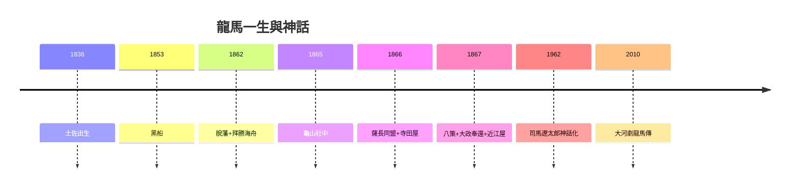

# 5.3 司馬遼太郎與龍馬神話（1962–2020）

## 1962–66：《龍馬來了》

司馬遼太郎連載《龍馬來了》（竜馬がゆく），把龍馬塑造成「無國籍的自由人、世界的龍馬」——暢銷數千萬冊，龍馬成為日本人氣第一的歷史人物（多次民調「最喜歡的偉人」奪冠）。

## 神話的成分

- 真實：薩長同盟、船中八策、大政奉還，皆有史料；
- 誇大：「世界」「自由」「脫藩即普世」多為司馬的投射（1960 年代日本經濟起飛期的自我形象）；
- 遮蔽：阿龍的貧困晚年、土佐的通緝、商社的逐利，都被浪漫化濾鏡淡化。

## 去世一百五十年後的龍馬

- 高知機場叫「龍馬機場」，啤酒、T 恤、動漫主角；
- 學界（平尾道雄→宮地正人）不斷「祛魅」，大眾不斷「復魅」；
- 真相：他不是完人，是**在正確的時間做了正確的事的凡人**——而這已經足夠偉大。

**因果閉環**：愛哭鬼（1.1）→ 脫藩者（2.3）→ 調和者（3.2）→ 死者（5.1）→ 神話（本節）。神話的燃料正是死亡：31 歲定格，永遠年輕，永遠正確。龍馬最幸運的事，是死得早——早到來不及犯錯，來不及讓人失望。
