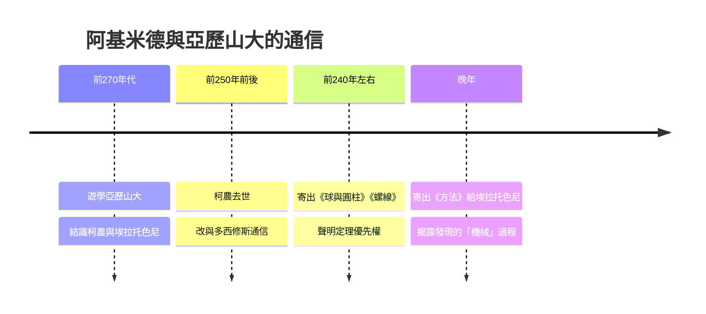

# 1.3 師承與通信：埃拉托色尼與多西修斯

現存阿基米德著作的前言，是重建其生平的最可靠線索。《方法》是寫給亞歷山大圖書館館長埃拉托色尼（Eratosthenes）的，《螺線》《球與圓柱》寫給多西修斯（Dositheus），《拋物線求積》同樣致多西修斯。由此可知，阿基米德雖身居敘拉古，卻以亞歷山大的核心學者為對話對象，形成了「西西里出題、亞歷山大存檔」的雙城結構。

埃拉托色尼正是後來測出地球周長的人；多西修斯則是天文學家。阿基米德與他們的通信並非寒暄，而是「發表」本身：他把新定理先寄給對方，附上證明，聲明優先權。他在信中常設「挑戰題」，甚至故意寄出錯誤的定理以試探對手是否認真驗證——這顯示當時學界已有嚴謹的優先權與誠信文化。

**因果分析**：師承與通信關係直接決定了阿基米德遺產的形態。前因是他在亞歷山大建立的私人友誼，後果是十五部左右著作以書信體保存，並在羅馬時代被整理成文集。因果驅動上，通信網絡對阿基米德是雙向壓力：對外，他必須不斷產出新定理維持聲望；對內，亞歷山大的批評迫使他補足嚴格證明——這就是《方法》與《球與圓柱》分工的來源：前者展示「如何想到」，後者展示「如何證明」。學術網絡不只是傳播管道，更是催生其雙層寫作風格的結構性原因。
