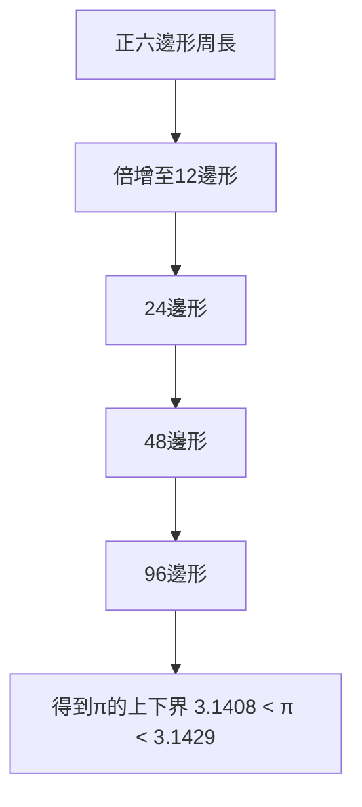

# 2.1 圓的度量與圓周率逼近

在《圓的度量》中，阿基米德提出三個命題，其中最著名的是圓周長與直徑之比介於兩個分數之間：

$$3\frac{10}{71} < \pi < 3\frac{1}{7}$$

他的方法是用正96邊形從內、外兩個方向「夾住」圓：內接多邊形周長小於圓周，外切多邊形周長大於圓周。從正六邊形出發，逐次倍增邊數至96，每次利用不等式技術控制根式計算的誤差。這種「上下界夾逼」在數學史上首次為 $\pi$ 給出了可檢驗的嚴格區間，而非埃及或巴比倫式的經驗近似值。

同一書中他還證明：圓面積等於以半圓周與半徑為兩邊的直角三角形面積，即

$$A = \frac{1}{2} \cdot (2\pi r) \cdot r = \pi r^2$$

這把圓的量度問題完全化約為圓周率問題。

**因果分析**：這項成就的因果鏈是「實務需求→數學方法」的典範。前因：敘拉古的航海、工程與曆法都需要圓的計算，傳統取 $\pi \approx 3$ 或 $\frac{22}{7}$ 誤差太大。後果：夾逼法確立了一種新的認識論——無理量雖不能窮盡，卻可以收斂到任意精度。這一方法直接源自歐幾里得《幾何原本》第十二卷的窮竭法，而阿基米德將其從「定性比較」升級為「定量計算」。更重要的是，它樹立了科學計算的原型：先建立上下界，再逐步收緊——兩千年後的數值分析與現代電腦求 $\pi$，用的仍是同一邏輯。
