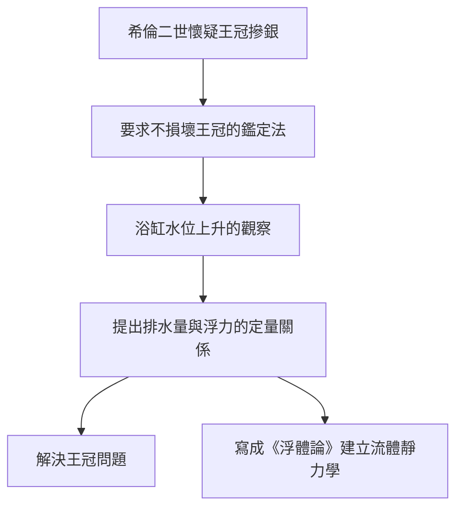

# 3.1 王冠問題與浮體原理

最著名的傳說來自維特魯威：希倫二世命工匠製作金冠，懷疑工匠摻入白銀，遂請阿基米德在不破壞王冠的前提下鑑定真偽。某日入浴時，他注意到水位隨身體浸入而上升，悟出解法，竟裸奔街上高呼「尤里卡（Eureka，我發現了）」。

科學上，真正的突破記載於《浮體論》：物體在流體中所受浮力，等於其排開流體的重量：

$$F_b = \rho_{液} \, g \, V_{排}$$

據此，若王冠與同重純金塊在水中排開的體積不同，即證摻假。設王冠重 $W$ ，水中視重 $W'$ ，則摻銀比例可由

$$\frac{V_{冠} - V_{金}}{V_{銀} - V_{金}}$$

精確算出。這是歷史上第一次將「不可直接觀測的量」（摻假比例）化約為「可測量」（排水量與重量）。

**因果分析**：王冠問題是「實務委託催生基礎科學」的典型。前因：王室信任（第1章）使鑑定任務落到阿基米德身上；鑑定要求「不破壞」排除了熔鑄測體積的直接辦法，逼出間接測量思路。後果有二：其一，浮力原理使船舶設計、比重測定成為可能，托勒密王朝的大船建造即受其惠；其二，《浮體論》以公理化方式處理流體，開創了流體靜力學這門學科。尤里卡傳說的廣泛流傳也有因果意義——它使「直覺閃現源於長期積累」的科學認識論進入大眾記憶，成為第5章遺產敘事的核心意象。
