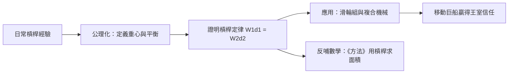

# 3.2 槓桿原理與重心理論

阿基米德在《平面圖形的平衡》中以公理化方法建立了槓桿定律：若槓桿兩臂長為 $d_1, d_2$，所掛重量為 $W_1, W_2$，則平衡條件為

$$W_1 d_1 = W_2 d_2$$

他進而定義了「重心」概念，並證明平行四邊形、三角形與拋物線弓形的重心位置。這是數學史上首次對「質量分布」作嚴格處理，也是把幾何公理體系擴張到物理量的第一次嘗試。

普魯塔克記載了那句名言：「給我一個支點，我就能移動地球。」據說他以此向希倫二世演示：用滑輪組把滿載的巨船輕鬆拉動，令國王當眾折服，並說「從今以後，我們的命令要聽從他的話」。

**因果分析**：槓桿研究呈現一條罕見的「理論—實務—理論」迴環。前因：敘拉古的港口與建築工程需要省力機械，王室演示提供了直接動機。後果：槓桿定律成為靜力學基石，經中世紀阿拉伯學者傳承至文藝復興，支撑了達文西與伽利略的機械研究；「重心」概念則預示了力矩、力偶乃至分析力學的觀念。更關鍵的內部迴環是：槓桿理論反過來成為《方法》中無限分割的猜想工具（第2.3節），而《方法》的猜想又需槓桿式的直覺來發現定理——沒有槓桿，就沒有那部「機械方法」之書。理論與工程互為因果，這正是阿基米德區別於純幾何學家之處。
