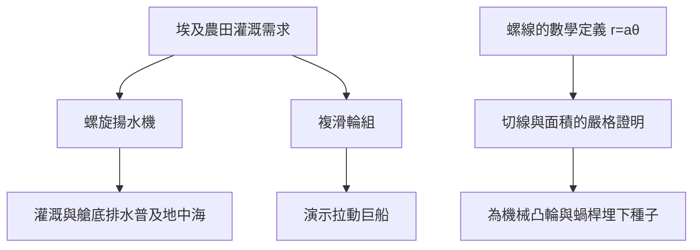

# 3.3 阿基米德螺線、滑輪與揚水機

阿基米德在《螺線論》中定義了一種新曲線：一點沿射線匀速移動，同時射線繞原點匀速旋轉，軌跡即為阿基米德螺線，極坐標方程為

$$r = a\theta$$

他證明了螺線第一圈的切線性質，並由此求得與半徑為 $a$ 的圓相比的面積關係，把「動態生成的曲線」引入希臘幾何——這在只承認尺規作圖的傳統中是大膽的擴張。螺線日後成為機械設計的基本曲線：凸輪、蝸桿與老式唱片紋路都是它的後裔。

工程方面，據維特魯威記載，阿基米德青年時代在埃及發明了螺旋揚水機（後世稱「阿基米德螺旋泵」）：螺旋管斜置於筒中，轉動軸時水沿螺旋上升。其提水能力可粗略由單位時間排水量估算：

$$Q \propto n \cdot A \cdot p$$

其中 $n$ 為轉速， $A$ 為螺旋截面積， $p$ 為螺距。此外，複滑輪（多滑輪組）使拉力按滑輪數倍縮減，是他「以幾何換力量」思想的直接應用。

**因果分析**：這一節體現「埃及經驗→數學抽象→機械返銷」的三角因果。前因：留學亞歷山大時目睹尼羅河氾濫後的人工提水，催生螺旋泵；提水的連續運動又反過來啟發他研究動態軌跡，寫成《螺線論》。後果：螺旋泵至今仍在灌溉與污水處理中使用，是少數延續兩千三百年的原設計；而「動態曲線」的合法化，為後世研究擺線、對數螺線直至解析幾何開了風氣。就其本人而言，滑輪演示換來的信任，使王室在戰爭危機來臨時第一個想到他——直接為第4章戰爭機械埋下伏筆。
