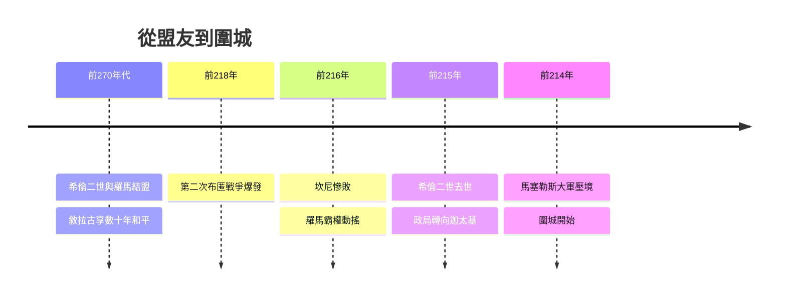

# 4.1 第二次布匿戰爭與敘拉古的抉擇

公元前218年，漢尼拔翻越阿爾卑斯山入侵義大利，第二次布匿戰爭爆發。迦太基在坎尼（前216年）殲滅羅馬大軍後，地中海西部的力量天平動搖，各附庸城邦被迫選邊。敘拉古的政局在此時發生關鍵變化：老王希倫二世於前215年去世，年僅十五歲的希倫尼穆斯繼位旋即遇刺，親迦太基派與親羅馬派爭鬥不休。最終，敘拉古在漢尼拔使者的勸說與內部政變的推動下，倒向迦太基。

這個決定有其邏輯：坎尼之戰後迦太基看似必勝，投機者押注新霸主。但它忽略了一個結構性事實——羅馬的動員能力遠超一次戰役的勝負。羅馬迅速重組軍團，並於前214年派執政官馬塞勒斯（Marcellus）率陸海軍進逼西西里。敘拉古從「羅馬盟友」變成「圍城目標」，只用了不到兩年。

**因果分析**：敘拉古之難是典型的「短視決策觸發長期風險」。前因：希倫二世時代的外交平衡，本質是承認羅馬霸權換取自治；他一死，制度性紐帶斷裂，年輕的繼承體系無法壓制軍事投機。後果：城邦的命運從此與一位七十五歲的數學家綁在一起——因為此前數十年的王室贊助（第1章）已把阿基米德培養成唯一的「技術儲備」，城破與否取決於他能否將幾何轉化為防禦。政治選擇影響戰爭，戰爭需求影響科學的方向：這條因果鏈說明，阿基米德晚年的研究重心轉向軍事工程，並非其本願，而是地緣政治強加的結果。
