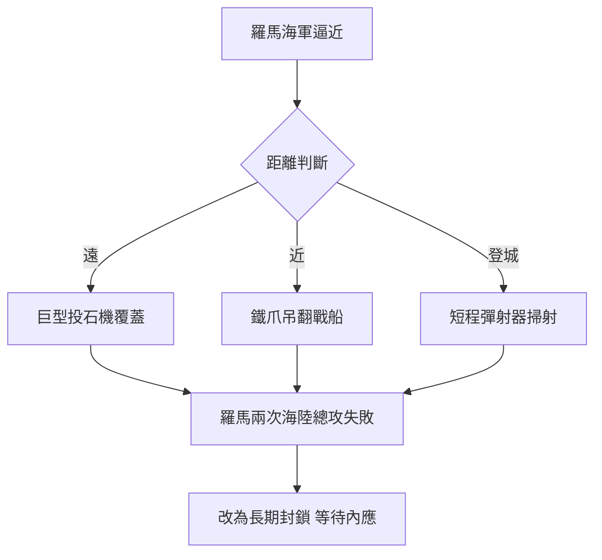

# 4.2 馬塞勒斯圍城：機械的威力

公元前214至前212年，馬塞勒斯以海陸並進圍攻敘拉古。據普魯塔克與波利比烏斯記載，城牆上部署了阿基米德設計的機械：遠距離的巨型投石機、近距離的小型彈射器、可以伸縮吊起羅馬戰船的「鐵爪」（claw），以及傳說中用銅鏡聚焦陽光焚燒船帆的「火鏡」。

機械的部署邏輯是分層防禦：敵船遠則以投石機覆蓋射程，逼近城牆則以鐵爪翻覆，登岸強攻則以短程機械掃射。羅馬士兵士氣崩潰，據載見到牆上伸出繩索即呼「阿基米德來了」而退。馬塞勒斯最終放棄強攻，改以長期封鎖消耗城中糧食，並等待內部親羅馬派作為內應。

物理上，投石機的射程取決於扭力儲能與臂長配比，其設計涉及槓桿原理的放大應用：

$$E \approx \tau \theta, \qquad v \sim \sqrt{\frac{2E}{m}}$$

即扭轉儲能轉化為彈丸動能。

**因果分析**：圍城之戰是阿基米德畢生理論的總驗收。前因：槓桿與滑輪研究（第3章）提供了力量放大的原理庫，王室工程傳統提供了工匠與材料；若無此前積累，臨時抱佛腳絕不可能造出分層火控體系。後果：機械雖未挽回城邦的命運，卻改寫了戰爭史的認知——波利比烏斯感嘆「一位數學家勝過十萬大軍」。這個案例讓羅馬精英首次意識到「科學即戰略資源」，直接促成羅馬人對希臘數學的矛盾態度：既敬畏其威力，又視之為異質文化。而圍城被迫轉入消耗戰，也決定了城破的方式——不是被機械擊敗，而是被飢餓與叛徒擊敗，這為阿基米德之死埋下伏筆。
