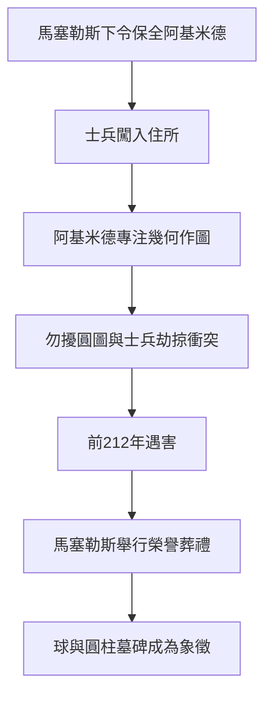

# 5.1 前212年：城破與死亡

敘拉古陷落之日，羅馬執政官馬塞勒斯曾下令保全阿基米德性命。據普魯塔克與李維的記載，劫掠中的羅馬士兵闖入阿基米德的居所，見他正在地上繪圖沉思。阿基米德只說了那句流傳千古的話：「不要弄壞我的圓。」士兵不識其人，拔劍將這位七十五歲的老人殺害。

馬塞勒斯聞訊深為惋惜，以榮譽葬禮安葬阿基米德，並優待其親屬。墓碑上依其遺願刻著內切於圓柱的球形，標誌著

$$V_{球} : V_{圓柱} = 2 : 3$$

這一他最自豪的定理。一個以理性度量世界的人，最終死於非理性的暴力，這一對比使他的死亡超越個人悲劇，成為希臘化科學時代終結的象徵。

**因果分析**：阿基米德之死的因果鏈起於第4章的政治抉擇。前因：敘拉古倒向迦太基招致圍城，圍城轉入巷戰使軍紀失控，有保護令而無執行機制。後果卻遠超一城一池：羅馬精英由此背負「野蠻征服文明」的道德債務，馬塞勒斯的懺悔與厚葬，正是羅馬此後系統掠取並翻譯希臘典籍的心理起點。死亡本身是偶然，但偶然發生的結構早已註定——當科學家被推上城牆，戰爭的暴力邏輯便不再區分演算與抵抗。
