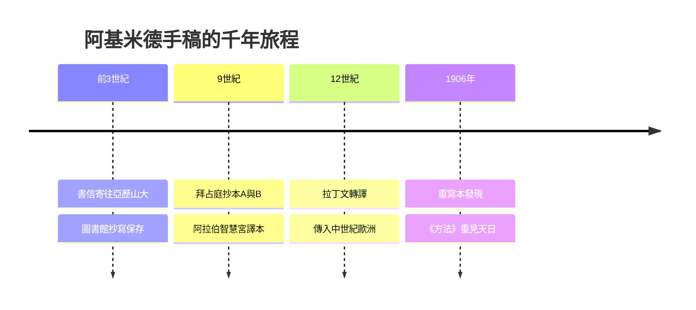

# 5.2 手稿流傳：從拜占庭到阿基米德重寫本

阿基米德著作的保存，本身就是一部因果交織的傳播史。原稿以書信體寄往亞歷山大，由圖書館抄寫保存。羅馬征服後，希臘文抄本流入拜占庭，九世紀時利奧主教主持整理出抄本A與抄本B。九世紀至十世紀，塔比·本·庫拉等阿拉伯學者在巴格達智慧宮將《球與圓柱》《螺線》《圓的度量》譯為阿拉伯文，使其在伊斯蘭世界生根。

中世紀拉丁西方經由西西里與西班牙重新發現這些文本，十二世紀克雷莫納的杰拉德據阿拉伯文譯本轉譯拉丁文。最傳奇的是1906年，丹麥學者海伯格在君士坦丁堡發現十三世紀的祈禱書重寫本，其羊皮紙下層正是失傳千年的《方法》《浮體論》希臘原文。現代多光譜成像技術使這些文字重見天日。

**因果分析**：手稿流傳的因果邏輯是「中心—邊緣」的接力。前因是第1章的亞歷山大通信網絡，製造了多份異地副本，避免單點滅失；每一次帝國更替都是一次篩選，拜占庭的抄寫傳統與阿拉伯的翻譯運動恰好形成互補備份。後果是阿基米德思想從未真正斷絕，只是以不同語言休眠，等待文藝復興的喚醒。重寫本的發現更反向證明：第2章窮竭法背後藏著一套完整的無限思想，若非羊皮紙被刮寫重用，我們至今仍會低估他的超前程度。
