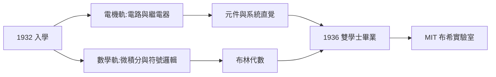
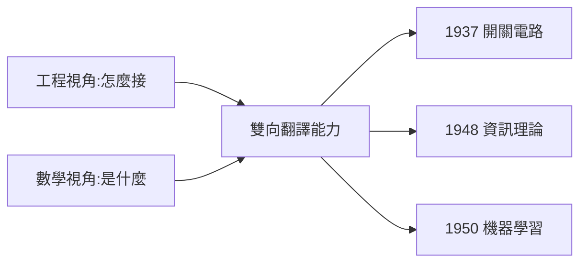

# 1.2 密西根大學雙修電機與數學（1932–1936）

1932 年，十六歲的香農進入密西根大學安娜堡分校。這四年他在兩個學院之間來回穿梭，最後同時拿下**電機工程**與**數學**兩個學士學位。這個「雙修」日後被史家視為他一生成就的縮影：把數學的抽象帶進工程，把工程的具體還給數學。

## 經濟大蕭條中的大學

- 1932 年正值大蕭條谷底，香農家境並不寬裕，他靠打工（包括給宿舍修理電器、用摩斯電碼為系館發信號的兼職傳說）與獎學金完成學業；
- 大學部的香農並非神童型的學生，成績偶有起伏，但選課方式極為獨特：刻意在工程學院與文理學院各修一半；
- 他在自傳式筆記中承認，當時並沒有宏大的計畫，只是「兩邊都覺得有趣」。

## 電機這一軌

- 學了電路理論、電子學、電話系統的基礎；
- 接觸到繼電器（relay）這種「用電控制電」的元件——它將在一年後的 MIT 碩士論文中成為主角；
- 工程訓練給他的是**系統思維**：任何複雜裝置都可以分解為元件與連接。

### 繼電器是什麼

繼電器的原理簡單得近乎樸素，卻承載了整個數位時代的起點：

- 一個電磁線圈：通電時吸下金屬銜鐵，帶動觸點閉合；
- 觸點閉合讓另一條電路導通——於是「小電流」控制了「大電流」；
- 十九世紀的電報中繼站就是用它轉發微弱信號，故名「繼電」；
- 對香農而言至關重要的是它的**雙態性**：要麼通、要麼斷，沒有中間狀態——這是天然的「位元載體」。

他把這個元件寫進了自己的思考詞彙表。日後從碩士論文（見 2.1）到 Theseus 老鼠（見 4.1），繼電器都是他手中最愛的建材。

## 數學這一軌

- 修了紐頓（N. R. Newson）等教授的微積分與高等代數課程；
- 關鍵的一門課是**符號邏輯**——他在這裡第一次正式遇見喬治·布林的代數（→ 詳見《布林傳記》第 3 章）；
- 布林在 1854 年《思維規律的研究》中把邏輯寫成代數，當時幾乎無人知曉其工程用途；
- 香農在課堂筆記裡寫下日後著名的觀察：「布林代數的符號 × 與 +，和開關的串聯與並聯，結構上完全一樣。」

### 兩個代數的對照表

香農日後在碩士論文第一章給出的對照，其實在密西根的課堂上就已成形：

| 布林代數 | 開關電路 | 含義 |
|----------|----------|------|
| $1$ | 電路導通 | 恒真 |
| $0$ | 電路斷開 | 恒假 |
| $x \cdot y$ | 串聯 | 兩者皆通才通 |
| $x + y$ | 並聯 | 任一通即通 |
| $\bar{x}$ | 常閉觸點 | 通斷互補 |
| $x = y$ | 兩網路等價 | 相同的導通行為 |

一個十九世紀哲學家的符號系統，與一個十九世紀工程師的元件，隔著八十年被一個二十歲的學生接了線。

## 雙軌結構的第一次合流

香農的密西根歲月可以概括為「兩條腿走路」：

兩條線在 1936 年合流：他拿著電機學士去 MIT 申請了**數學系**的研究所，同時在校內找了份工程工作。這種「身份是數學家、身體在實驗室」的安排，將直接催生 1937 年的碩士論文（見 2.1）。

### 大學時期的軼事

香農的大學生活並非只有課業：

- 他加入了一個以惡作劇聞名的兄弟會，是宿舍裡公認的「會修任何東西的人」；
- 他用繩滑輪和木製結構改裝過宿舍樓梯，讓室友們「省一層樓」——校方不太高興，同學極為振奮；
- 他開始練習雜耍與獨輪車——這兩項技藝五十年後都將以機器的形式重現（見 5.1）；
- 據他自己回憶，大學時代最重要的收穫是「學會了在兩種完全不同的思考方式之間自由切換」。

這些軼事合起來畫出了一個未來工程師哲學家的輪廓：玩心、動手、以及對「跨界」的天然偏好。

## 同時代人的座標

| 人物 | 當時的動向 | 與香農的交會 |
|------|-----------|--------------|
| 圖靈 | 1936 年發表可計算性論文 | 1943 年在貝爾實驗室相見（見 3.1），→ 詳見《圖靈傳記》 |
| 馮紐曼 | 剛提出算子理論、即將轉向物理 | 日後成為資訊理論的頭號推廣者（見 3.3），→ 詳見《馮紐曼傳記》 |
| 布林 | 已去世八十二年 | 其代數在 1938 年被香農「工程化」（見 2.2），→ 詳見《布林傳記》 |
| 麥卡錫 | 尚在讀中學 | 1956 年達特茅斯會議共同發起 AI（見 4.2），→ 詳見《麥卡錫傳記》 |

## 關鍵年表

| 年份 | 事件 | 後續影響 |
|------|------|----------|
| 1932 | 入學密西根大學 | 開始雙修生涯 |
| 1933–1934 | 修符號邏輯，讀到布林代數 | 碩士論文的思想源頭 |
| 1934–1935 | 電機課程接觸繼電器 | 開關電路理論的材料 |
| 1935–1936 | 雜耍與獨輪車入門 | 晚年機器作品的種子（見 5.1） |
| 1936 | 同時獲電機與數學兩學士 | 攜雙軌進入 MIT |

## 深層因果：為什麼雙修如此致命

單修電機的香農會成為一位優秀的工程師——也許設計出更好的交換機；單修數學的香農會成為一位合格的邏輯學家——也許研究布林代數的某個推廣。但**雙修**造就的是第三種人：

- 工程給了他「問題」，數學給了他「語言」；
- 一般工程師面對複雜電路時想的是「怎麼接」，香農想的是「這在代數上是什麼」；
- 一般數學家面對布林代數時想的是「它有什麼定理」，香農想的是「它對應什麼東西」；
- 這種雙向翻譯能力，將在 1937 年（開關電路）、1948 年（資訊理論）兩次引爆，並在 1950 年（機器學習）第三次點火。

**因果**：密西根四年沒有驚天動地的事件，卻完成了香農的「思想配線」——把布林的邏輯代數與繼電器的開關動作，預先接在了一起。大蕭條的物質匱乏反而強化了他「用最簡單元件做最聰明事情」的工程美學，這種美學貫穿他的一生：從碩士論文到迷宮老鼠，從雜耍機器人到尤克斯飛船（THROBAC，用羅馬數字算術的機器）。

## 小結

- 雙修不是巧合而是方法：香農一生都在「兩個學科的接縫」上工作；
- 布林代數與繼電器在密西根分別進入他的視野，兩者結構上的同構已被他在課堂筆記中察覺；
- 大蕭條與兄弟會文化塑造了他的務實與玩心，雜耍與獨輪車是晚年作品的伏筆；
- 1936 年畢業後，他帶著兩張學士證書前往波士頓，敲開了 MIT 與萬尼瓦·布希（Vannevar Bush）微分分析儀的大門（見 1.3）。
