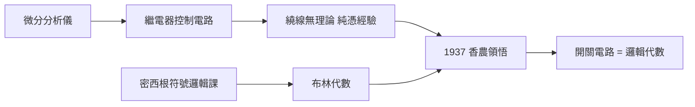
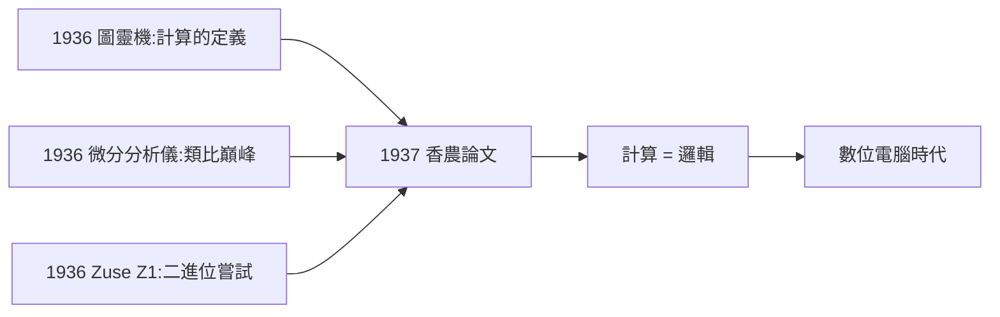

# 1.3 MIT 與布希微分分析儀（1936）

1936 年夏天，香農進入麻省理工學院：名義上是數學系研究生，實際上在萬尼瓦·布希（Vannevar Bush）的實驗室裡擔任「布希微分分析儀」（Bush Differential Analyzer）的維護員。這臺房間大小的類比計算機，成了把他兩條思想軌道焊在一起的電路板。

## 微分分析儀：類比時代的計算巨獸

- 微分分析儀是布希在 1927–1931 年間建造的機械式類比計算機，用旋轉軸的角度代表變數，用齒輪比做乘法、圓盤積分器做積分，可解常微分方程；
- 它是當時全美最先進的計算裝置之一，工程系用它算輸電網、彈道與振動問題；
- 香農的工作是操作與維修：監控馬達、更換齒輪、根據要解的方程重新接線（「set up」一次題目可能要一兩天）。

### 一臺機器的解剖

理解香農當年面對的怪物，需要知道它由哪些部件構成：

| 部件 | 功能 | 類比於今日 |
|------|------|-----------|
| 積分器（圓盤＋滾輪） | 對輸入軸的轉角做積分 | 積分運算 |
| 加總器（差動齒輪） | 把兩個軸的轉角相加減 | 加法器 |
| 函數桌 | 手工輸入函數值 | 輸入裝置 |
| 輸出桌 | 筆隨軸移動畫出曲線 | 繪圖輸出 |
| 繼電器控制櫃 | 控制馬達啟停與時序 | 控制器／作業系統 |

香農的職責覆蓋最後一行——而那正是整臺機器「最沒有理論」的部分。

### 類比與數位的分水嶺

微分分析儀是一個絕佳的教科書案例，說明「類比」與「數位」的哲學差異：

- **類比**計算：用一個物理量（角度、電壓）去「扮演」另一個量，計算過程即物理過程，精度受限於機械摩擦與雜訊；
- **數位**計算：把量離散化為 0 與 1，只要電路不翻錯狀態，精度可以無限堆疊；
- 微分分析儀運行時整個房間轟鳴，一個齒輪的磨損就能毀掉一星期的計算；
- 而香農在 1937 年證明：用繼電器的雙態性，計算可以變成**純粹的邏輯**，與機械精度無關。

十年後的 ENIAC 與二十年後的商業電腦，都站在這個分水嶺的數位一側（→ 詳見《馮紐曼傳記》第 4 章）。

## 繼電器：機器的神經

為了控制上百個繼電器與馬達的啟動順序，分析儀配有一套**繼電器控制電路**。香農每天面對的，正是這個問題：

- 控制電路龐雜、繞線全憑技師經驗，沒有任何系統性的設計方法；
- 他手上恰好握著密西根時代學到的兩件工具：布林代數與繼電器；
- 他意識到：繼電器的「通／斷」狀態，正好可以對應布林代數的「真／假」，串聯對應「與」，並聯對應「或」，常閉觸點對應「非」。

## 從機械到數位的黎明

香農在 MIT 的處境本身就是一則隱喻：

- 他維護的是**類比**計算的巔峰之作，卻在它的繼電器陰影裡寫下了**數位**計算的序章；
- 布希的分析儀在數年後被雷達、戰爭與電子數位計算機的浪潮淘汰，而香農從它身上學到的「繼電器=邏輯」，卻成為所有數位機器的基礎；
- 布希本人對這位安靜的博士生印象深刻，後來在戰時成為美國科研總管（OSRD），而香農則去了貝爾實驗室做火控與密碼（見 2.3、3.1）。

## 順帶的收穫：布希的知識網路

在布希實驗室的這一年，香農還學到了布希本人的另一項特質——**跨學科的組織能力**：

- 布希是工程、數學、管理三棲人物，1945 年將發表著名文章《誠如我們所想》（As We May Think），提出 Memex 超文本構想；
- 香農在他身邊看到「一個人如何同時是工程師、數學家與遠見者」，這種範式直接影響了他後來在資訊理論與 AI 上的雙線工作（見 4.2）。

### 布希其人：改變美國科學的工程師

布希對香農的意義超出了一個老闆：

- **學術父親**：他允許這個年輕人在維修之餘做自己的研究，論文的題目就誕生於他的實驗室；
- **組織家**：二戰期間布希執掌美國科研開發局（OSRD），協調雷達、原子彈、青黴素等計畫，是把「科學動員」制度化的第一人；
- **人脈樞紐**：布希深知香農的價值，1940 年推薦他進普林斯頓高等研究院、繼而把他的職業路徑引向貝爾實驗室——沒有布希，就沒有 1948 年的貝爾實驗室香農（見 2.3）。

師生二人的關係構成一個有趣的對照：布希建造了「算得更多」的機器，香農證明了「算得更對」的原理；布希組織了戰爭的科學，香農則在戰爭中孕育了和平時代的通訊。

### 個人生活的插曲

在 MIT 期間，香農與同系的學生結婚（後於 1941 年離婚）。這段早期的婚姻很少被提起，但 1949 年他與貝爾實驗室的數學家瑪麗·摩爾再婚，成就了終身的夥伴關係（見 5.3）。晚年的香農回顧人生時說，他一生最重要的決定都與「追隨好奇心」有關——包括對人的好奇心。

## 關鍵年表

| 年份 | 事件 | 後續影響 |
|------|------|----------|
| 1936 夏 | 入 MIT 數學系，任分析儀維護員 | 與繼電器朝夕相處 |
| 1936 秋 | 萌生「開關=布林代數」想法 | 碩士論文啟動 |
| 1937 | 寫成碩士論文《繼電器與開關電路的符號分析》 | 見 2.1，數位電路設計的起點 |
| 1938 | 論文發表於 AIEE 期刊 | 見 2.2，工程界接受 |
| 1940 | 轉任布希建議的研究助理，撰博士論文 | 轉向數學與遺傳學 |

## 1936 年的時代背景：計算的史前夜

把鏡頭拉遠，1936 年本身是計算史上奇蹟般的年份：

| 事件 | 年份 | 意義 |
|------|------|------|
| 圖靈發表〈論可計算數〉 | 1936 | 「計算」的數學定義，圖靈機誕生（→ 詳見《圖靈傳記》第 3 章） |
| 布希微分分析儀全速運轉 | 1936 | 類比計算的巔峰 |
| 香農進入 MIT | 1936 | 數位計算的序章 |
| 德國 Zuse 開始建造 Z1 | 1936 | 第一臺二進位可編程機器的嘗試 |

同一年，英國人在紙上定義計算，美國人在鋼鐵裡模擬計算，德國人在公寓裡焊接計算——三條線尚未相連。香農的碩士論文將是把它們焊在一起的第一道焊縫：他證明了**計算與邏輯是同一件事**，這正是圖靈機思想在硬件中的第一聲回響（見 2.1）。

**因果**：這一年是「工程師的日常」如何變成「歷史的轉折」的教科書案例。分析儀太複雜，繼電器太多，繞線太亂——這些**工程痛點**逼著香農去尋找理論；而密西根的數學課恰好供給了理論。沒有微分分析儀的雜務，就沒有 1937 年那篇論文；沒有那篇論文，數位電路設計可能還要在試錯的黑暗中多走十年。

## 小結

- MIT 一年，香農同時站在**類比計算的終點**與**數位計算的起點**；
- 微分分析儀的解剖顯示：整臺機器唯一「沒有理論」的部分——繼電器控制——恰是他選中的題目；
- 布希給他的是場景（繼電器控制）、榜樣（跨學科大師）與職業引路人（普林斯頓與貝爾實驗室）；
- 1937 年，他把腦中合流的兩條線寫成碩士論文——那將被譽為「二十世紀最重要的碩士論文」（見 2.1）。
