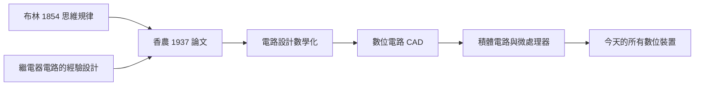
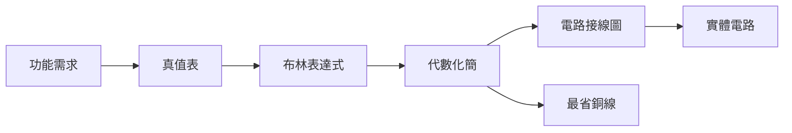

# 2.1 碩士論文：繼電器與開關電路（1937）

1937 年，二十一歲的香農寫下碩士論文《繼電器與開關電路的符號分析》（A Symbolic Analysis of Relay and Switching Circuits）。這篇論文把布林的邏輯代數變成了電路的計算語言，被後世稱為「二十世紀最重要的碩士論文」——因為今天的每一臺電腦、每一支手機、每一片晶片，都是它的後裔。

## 論文的核心命題

香農證明了一件在此之前無人系統表述的事：**開關電路是一個代數系統**。

- 繼電器的兩個狀態（通電閉合／斷電開啟）對應布林代數的兩個值（1／0）；
- 觸點串聯 = 邏輯「與」（$x \cdot y$）；並聯 = 邏輯「或」（$x + y$）；
- 常閉觸點 = 邏輯「非」（$\bar{x}$）；
- 於是任何開關網路都可以寫成布林表達式，任何布林表達式也可以化簡成更省錢省料的電路。

這意味著電路設計從「技藝」升級為「數學」：

$$f(x,y,z) = x\bar{y} + \bar{x}y \quad \Longleftrightarrow \quad \text{一個確定的觸點網路}$$

## 三大貢獻

1. **表示**：給出開關電路的完整代數語言（開關函數）；
2. **化簡**：證明布林的公理與定理全部適用於電路，可機械化地化簡設計；
3. **綜合**：提出從邏輯規格「合成」出電路的系統方法，包括處理不可逆接觸、自鎖（self-holding）電路等實際工程問題。

## 一個最小例子：香農式的「翻譯」

論文的精神可以用一個最小的電路示範。樓梯燈的「雙開關」問題：樓上樓下各有一個開關，撥動任何一個都要改變燈的亮滅。直覺上要畫半天接線圖，香農的做法是：

1. 定義：$x$、$y$ 為兩個開關的狀態（1 = 位置 A，0 = 位置 B）；
2. 寫出真值表：燈亮當且僅當 $x = y$；
3. 譯成代數：$f(x,y) = x\,y + \bar{x}\,\bar{y}$；
4. 按代數式接線：$x$ 與 $y$ 串聯，再與 $x$、$y$ 的常閉觸點串聯並聯。

四步之內，「想清楚」與「接起來」完全等價。這個今天寫在每本數位邏輯教材第一頁的方法，1937 年是世界首創。更複雜的例子——如「投票電路」（少數服從多數）$f = xy + xz + yz$——在論文中被同樣輕鬆地處理，並進一步示範了化簡：代數恆等式每用一次，銅線就少繞一尺。

### 化簡即省錢

對貝爾系統這樣的企業，這不是審美而是損益：

- 電話交換網有數以十萬計的繼電器觸點；
- 每省一個觸點，意味著材料、工時、故障率與維護成本的同時下降；
- 香農在論文中證明：化簡可以**機械化**——給定布林表達式，存在系統程序找到（或逼近）最簡電路；
- 「機械化的最簡化」這個目標，三十年後演化成邏輯綜合軟體，今日晶片設計的 EDA 工具鏈仍是它的直系子孫。

## 為什麼如此重要

- 在 1937 年之前，設計一個多繼電器電路靠的是直覺、查表與試錯；化簡一個電路意味著省下真金白銀的銅線與觸點；
- 香農之後，工程師可以在紙上證明「這個電路已是最簡」，並用代數變換而非拆裝來改進設計；
- 更深遠的是：論文隱含了一個革命性觀念——**電路是會思考的**。既然邏輯命題可以變成觸點網路，那麼機器就能執行推理。這是從「計算機器」到「邏輯機器」的觀念跳躍。

### 同代人的遲來認識

有趣的是，這篇論文的意義是逐步被認識的：

- 1937 年，貝爾與 AIEE 的工程師視之為「有用的交換機設計工具」；
- 1940 年代，建造 ENIAC 與 EDVAC 的團隊把它當作**設計教科書**（→ 詳見《馮紐曼傳記》第 4 章）；
- 1950 年代，晶體管取代繼電器，但「開關代數」原封不動地平移——因為電晶體同樣是雙態開關；
- 1980 年代，邏輯綜合、可測性設計、硬件描述語言——整個數位設計自動化大廈都奠於其上；
- 學界因此給它「二十世紀最重要碩士論文」之譽——以工程影響力而言，並不誇張。

## 事件關聯與前因後果

| 年份 | 事件 | 與本論文的關係 |
|------|------|----------------|
| 1854 | 布林出版《思維規律的研究》 | 提供了代數系統（→ 詳見《布林傳記》第 3 章） |
| 1932–1936 | 香農在密西根修符號邏輯 | 思想來源（見 1.2） |
| 1936 | MIT 微分分析儀維護工作 | 問題場景（見 1.3） |
| 1937 | 論文完成，獲西屋獎 | 工程界首次正視 |
| 1938 | 論文發表於 AIEE | 見 2.2 |
| 1945 前後 | ENIAC 與 EDVAC 誕生 | 數位電路全面採用其方法，→ 詳見《馮紐曼傳記》 |

**因果鏈**：布林的純數學 → 密西根課堂 → 繼電器的實務痛點 → 1937 論文 → 數位電路革命 → 現代電腦。這條鏈上每一環都必不可少：沒有布林的抽象，香農只有經驗；沒有繼電器的具體，布林只是冷僻的哲學代數。

## 榮譽的第一次來訪

論文的品質很快獲得機構承認：

- 1937 年，香農以此工作獲**西屋（Westinghouse）美國研究生獎學金**；
- 1938 年論文在 AIEE 發表後，1940 年獲**阿爾弗雷德·諾布爾獎**（Alfred Noble Prize，工程學界對年輕人的重要獎項，與諾貝爾獎無關）；
- 這些獎項確認了一件事：數學系的研究生做出來的工程論文，比所有工程師的都好——雙修的威力第一次公開亮相（見 1.2）。

## 深層因果：一篇論文如何改變產業節奏

反事實思考可以看清這篇論文的分量：

| 若無香農論文 | 可能的歷史 |
|--------------|-----------|
| 電路設計繼續依賴經驗規則 | 早期電腦設計週期更長、成本更高 |
| 化簡靠試錯 | 複雜電路的可靠性瓶頸更早出現 |
| 邏輯與硬件的聯繫延後 | 布林代數可能晚十年進入工程 |
| 數位革命或許不變，但更慢 | 電腦普及的臨界點推遲 |

當然，歷史未必只有一條路——圖靈的理論、戰爭的需求（→ 詳見《圖靈傳記》第 4 章）終會呼喚出某種等效工具。但香農把它**提前並系統化**了：他給的不只是一個方法，而是一整套可教、可學、可傳播的語言。語言一旦流通，思想的速度就不再受個人天賦限制。

## 小結

- 碩士論文完成了「邏輯↔電路」的雙向翻譯，是**數位時代的第一塊基石**；
- 化簡即省錢：抽象代數直接連到企業損益表，這是理論改變產業的教科書案例；
- 它同時是工程論文（省銅線）與哲學論文（機器可推理）；
- 1938 年論文正式發表後，這套方法如何在工程界傳播、如何回饋到布林的身後之名，見 2.2。
