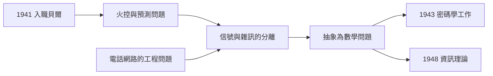
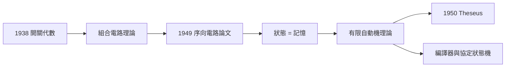

# 2.3 貝爾實驗室（1941）

1941 年，香農取得數學博士學位後，加入紐約市西街（West Street）的貝爾電話實驗室，任國防研究組（D 部門）研究員。這裡是當時世界最大的通訊科技聖殿，也正因戰爭動員而全速運轉。香農在這裡度過了十五年（1941–1956），完成了資訊理論——但他入職的第一份工作，卻是讓高射砲打得準。

## 入職的時代背景

- 1940–1941 年，美國尚未參戰，但已全面備戰：貝爾實驗室承接了大量軍方專案；
- 香農的第一項任務是**火控系統**（fire control）：研究如何讓防空砲根據飛機的運動預測彈道。他與數學家魏佛（Warren Weaver）等人合作，把「預測未來位置」化為統計與伺服控制問題；
- 這項工作看似與資訊理論無關，實則高度相關：**預測 = 從帶雜訊的觀測中提取信號**，這正是資訊理論的核心母題。

### 火控問題如何塑造資訊論

值得把「預測」與「資訊」的關係說透：

- 雷達回波帶著雜訊，炮手據此瞄準會有誤差——誤差就是**不確定性**；
- 要減少不確定性，必須利用目標運動的**統計規律**（飛機不會瞬間轉 90 度）；
- 於是問題變成：觀測數據裡究竟含有多少「關於未來位置」的資訊？
- 這個問法與兩年後的密碼問題（密文裡含多少「關於明文」的資訊）結構完全相同；
- 兩者共用同一件工具：**機率論下的信號分離**。

火控、密碼、通訊——三個戰時任務其實是同一個問題的三種偽裝。香農的天才在於看穿偽裝，直接攻擊本質。

## 貝爾實驗室提供的環境

貝爾實驗室給了香農三樣 MIT 給不了的東西：

1. **真實的通訊系統**：電話網路、電視傳輸、打字電報機——「傳輸資訊」在此不是哲學概念而是每日的工程問題；
2. **頂尖同儕**：包括提出脈衝編碼調變（PCM）構想的瑞夫斯（Alec Reeves）、後來共同寫出《通訊的數學理論》書籍版序言的魏佛；
3. **自由研究的文化**：D 部門主管布萊克（Harold Black，負回饋放大器的發明人）鼓勵研究員在軍事任務之餘做純理論。

### 黃金時代的實驗室

1940 年代的貝爾實驗室是怎樣的地方？

- 西街大樓裡，物理學家、工程師、數學家在同一層樓喝咖啡——電晶體（1947）將在這棟樓誕生；
- 公司壟斷利潤供養研究，「有用的純粹研究」成為制度；
- 理論組的慣例是「走廊研討會」：任何人都可以在黑板上寫下問題，路過者隨時加入；
- 香農後來說，貝爾實驗室最好的地方是「周圍總有人比你聰明，而且他們都願意跟你聊」。

電晶體的三位發明人（巴丁、布拉頓、蕭克利）與香農同樓共事——1947 年的電晶體與 1948 年的資訊理論在同一棟樓裡誕生，這對「數位時代雙胞胎」的巧合，堪稱科學史的黑色幽默（→ 詳見《Fairchild半導體》相關傳記——電晶體的商業化將塑造矽谷）。

## 從開關代數到交換系統

香農沒有放下開關代數：貝爾實驗室的電話交換機正是繼電器的天下，他的 1938 論文直接用於**交換電路設計**。他在此寫下了論文〈計算機的繼電器電路分析〉（1949 年正式發表），系統處理了「序向電路」——帶記憶的電路，其狀態演化類似自動機。這篇論文日後被視為**有限狀態機理論**的奠基文獻之一，與圖靈機理論遙相呼應（→ 詳見《圖靈傳記》第 3 章）。

### 序向電路：記憶的數學

這篇論文的關鍵一步是引入「狀態」：

- 組合電路：輸出只取決於當前輸入（如 2.1 的樓梯燈）；
- 序向電路：輸出還取決於**歷史**——電路必須「記得」過去；
- 香農用狀態圖（state diagram）刻畫：節點是狀態，邊是輸入導致的轉移；
- 這與圖靈機的「狀態＋帶」結構同構，也與十年後的神經網路、自動機理論、乃至編譯器的詞法分析一脈相承。

「記憶＝狀態」這個抽象，讓繼電器從開關躍升為**機器的神經元**——1950 年的 Theseus 老鼠就是用 75 個繼電器搭出一個會記路的大腦（見 4.1）。

## 大戰中的雙線生活

1941–1945 年間，香農過著雙面人的生活：

- 白天的官方任務：火控、密碼分析設備（與 X 系統——羅斯福與邱吉爾之間的越洋加密電話）；
- 晚上的私人思考：把「通訊」抽象成數學——什麼是訊息？如何度量它？雜訊的極限在哪裡？
- 他的上司後來回憶：香農常在辦公室裡拋雜耍球、騎單輪車走過走廊——這位「看起來最不像在工作的研究員」，正在腦中搭起整個資訊時代。

## 關鍵年表

| 年份 | 事件 | 後續影響 |
|------|------|----------|
| 1940 | 普林斯頓高等研究院一年 | 接觸邏輯學與數學前沿 |
| 1941 | 入職貝爾實驗室 D 部門 | 通訊問題的實戰場 |
| 1941–1942 | 火控與伺服預測研究 | 「信號 vs 雜訊」母題 |
| 1942 前後 | 參與 X 系統語音加密 | 通往密碼學（見 3.1） |
| 1943 | 與圖靈會面 | 兩人思想的相互點燃（見 3.1） |
| 1945 | 完成〈密碼學的數學理論〉機密報告 | 資訊理論的密室前身（見 3.1） |
| 1947 | 電晶體在實驗室誕生 | 與資訊理論並稱數位時代雙胞胎 |
| 1948 | 〈通訊的數學理論〉 | 兩年思考的總爆發（見 3.2） |
| 1949 | 與瑪麗結婚；序向電路論文 | 個人與學術的雙豐收 |

**因果**：貝爾實驗室是香農理論的「反應爐」。火控教他對付雜訊，交換機讓他吃透繼電器，密碼學逼他量化「訊息的隱藏與傳遞」。戰爭把一個愛玩的大男孩變成了兩門新學科的父親——而第一顆成熟的果實，將在 1943 年與一位從英國來的訪客有關（見 3.1）。

## 個人生活：瑪麗與雜耍

貝爾實驗室也是香農終身生活形態的定型之地：

- 1949 年 1 月，他與實驗室數學家瑪麗·伊麗莎白·摩爾（Mary Elizabeth Moore）結婚——她是貝爾的數值分析員，兩人因合作火控計算相識；
- 婚後育有兩子一女；瑪麗成為他晚年所有「玩具宮殿」的合作者與守護者（見 5.1）；
- 他把雜耍、獨輪車帶進實驗室，在走廊上練習拋接——同事起初錯愕，後來習以為常；
- 他的辦公室門上常年貼著一張字條：「**我在做與不通話的電話交換機有關的研究**」——半是自嘲半是掩護的幽默。

## 小結

- 貝爾實驗室時期是香農從「電路數學家」轉型為「通訊數學家」的關鍵十五年；
- 火控、密碼、通訊是同一問題的三種偽裝，香農看穿了本質；
- 開關代數在此落地為交換機設計與序向電路理論，「狀態＝記憶」成為機器智能的橋樑；
- 戰時的密碼工作將把他推向歷史性的一步：1948 年的《通訊的數學理論》（見 3.2）。
