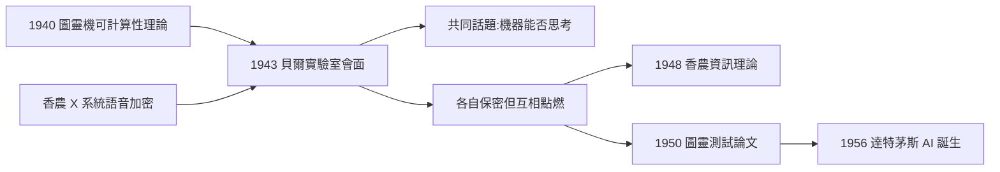
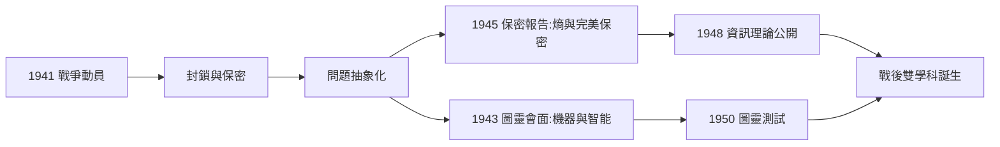

# 3.1 戰時密碼學與圖靈會面（1943）

1943 年初，一位年輕的英國數學家從倫敦來到紐約，走進貝爾實驗室。他是艾倫·圖靈（Alan Turing），以布萊奇利園（Bletchley Park）首席密碼顧問的身分，前來協調英美密碼情報的銜接。而香農正在同一棟樓裡做語音加密。兩人共進了幾次午餐與下午茶。這是二十世紀密碼學與資訊理論最富意味的一次交會（→ 詳見《圖靈傳記》第 4 章）。

## 兩人的戰時任務

| 人物 | 任務 | 核心問題 |
|------|------|----------|
| 香農 | X 系統：羅斯福—邱吉爾越洋語音加密 | 如何讓語音在敵方截聽下不可讀 |
| 圖靈 | Enigma 破解與與美方的情報銜接 | 如何從密文反推明文 |

X 系統的核心是「一次性密碼本」技術的工程化：把語音信號與按嚴格隨機產生的雜訊相加，使密文在統計上與純雜訊無法區分。香農為此研讀了克肖夫（Kerckhoffs）、赫爾（Hill）等人的古典密碼學，並逐漸形成一個革命性的問題框架：

> **如何「度量」一個密碼系統的保密性？敵人從密文裡究竟能學到多少？**

「學到多少」——這個提法預設了一個量：資訊量。香農發現，密碼學與通訊是同一枚硬幣的兩面：一個是刻意隱藏資訊，一個是盡力傳遞資訊，兩者都需要「資訊量」的度量衡。

### 一次很有意味的誤會

圖靈到訪初期發生了一個反映戰時體制的故事：

- 圖靈自然地想與香農討論密碼分析的技術細節；
- 香農不得不提醒：他無權討論自己正在做的保密工作；
- 圖靈愣了一下，笑著說：「抱歉，我忘了我們分屬不同的保密體系。」
- 兩人於是把話題轉向了雙方都不涉密的領域：**機器與智能**。

這個小插曲有巨大的象徵意義：**保密法規強制兩位天才只談未來**。如果當年他們可以自由交流密碼細節，也許只會交換一些工程技巧；正因為不能，他們談了計算、學習與思維——談出了 AI 的史前史。

## 圖靈—香農的午餐對話

圖靈在紐約停留的幾個月裡，與香農多次對談。有趣的是，兩人都受保密誓詞約束，**不能談論彼此最核心的工作**。據香農回憶，他們聊的最多的是：

- **機器能否思考**：圖靈向香農談起「教機器下棋、學習」的想法（其著名的 1950 論文〈計算機器與智能〉在此已有草稿，→ 詳見《圖靈傳記》第 5 章）；
- 兩人對「大腦作為一種開關網路」的想像不謀而合；
- 他們交換了對自動機與計算本質的看法，卻各自守著密碼學的祕密。

香農後來說：「我們談了很多關於機器思考的東西，這在當時還是很瘋狂的想法。」九個月後，圖靈在貝爾實驗室的報告與香農的私人研究，將在各自的方向上開花。

## 保密報告裡的資訊論雛形

1945 年 9 月，香農完成貝爾實驗室機密報告〈密碼學的數學理論〉（A Mathematical Theory of Cryptography）。在這份報告裡：

- 他首次以定量方式定義了**完美保密**（perfect secrecy）：明文與密文在統計上完全獨立，則密文不含任何資訊；
- 他證明了「一次性密碼本」是唯一可達完美保密的方案；
- 報告中已出現熵、冗餘度、互資訊等概念的原型——**資訊論先在密碼的暗室中受孕，兩年後才公開出生**。

### 完美保密的數學表述

用後來的記號（報告中已具雛形），完美保密的條件可以寫成：

$$P(\text{明文} = M \mid \text{密文} = C) = P(\text{明文} = M)$$

也就是說：知道密文，不會改變你對明文的任何信念——密文的互資訊為零：

$$I(M; C) = 0$$

香農進一步證明：要達到完美保密，密鑰的熵必須不小於明文的熵——**秘密至少要與消息一樣大**。一次性密碼本之所以安全，正因為它用同樣長的真隨機密鑰逐字相加。這條「熵守恆」式的結論，使保密性第一次成為可計算、可比較、可設計的量。

### 為什麼密碼學是資訊論的「保密先驅」

時間順序值得強調：

1. 1945 年的密碼報告已有熵的完整使用（機密，讀者寥寥）；
2. 1948 年的通訊論文公開同一套理論（讀者全球）；
3. 1949 年，兩份文獻幾乎同時解密出版——密碼學界與通訊界同時獲得同一件武器；
4. 1970 年代的公開密鑰密碼學（Diffie-Hellman、RSA）直接以香農 1949 框架為起點：先定義「計算上不可區分」，再設計協定。

可以說：**現代密碼學是資訊論的第一個應用學科**，早於編碼理論的工程兌現（見 3.3）。

## 事件關聯與前因後果

| 年份 | 事件 | 後續影響 |
|------|------|----------|
| 1940 | 圖靈發表可計算性論文 | 兩人共享「計算」的數學觀（→ 詳見《圖靈傳記》第 3 章） |
| 1941–1942 | 香農參與 X 系統 | 密碼學的問題框架成型 |
| 1943 | 圖靈訪美，兩人會面 | 機器智能的對話，互相印證 |
| 1945 | 〈密碼學的數學理論〉報告 | 保密版資訊論 |
| 1948 | 〈通訊的數學理論〉 | 資訊論公開誕生（見 3.2） |
| 1949 | 兩份論文同時解密出版 | 密碼學的數學化（見 3.3） |

## 戰爭作為思想的反應爐

回望整個戰時期（1941–1945），可以看到一個規律：**封鎖催生抽象**。

- 因為不能發表，香農把想法寫在機密報告與私人筆記裡，反覆打磨；
- 因為不能談細節，他把問題抽象到更高的層次——細節屬於僱主，抽象屬於自己；
- 戰後他只需把私人的抽象「脫密」，就得到了兩門新學科：資訊理論（1948）與數學密碼學（1949）；
- 圖靈走了同樣的路徑：布萊奇利園的炸彈機經驗沉澱為戰後的 ACE 設計與智能思想（→ 詳見《圖靈傳記》第 4、5 章）。

戰爭在此扮演了殘酷而高效的角色：它同時供給了**最緊迫的問題**（打贏戰爭）與**最封閉的環境**（保密），而抽象思維恰好在這種「高壓＋孤絕」的條件下最為活躍。

**因果**：戰爭製造了一個奇特的房間——兩位最聰明的頭腦，因為不能談論「密碼」，只好談論「會思考的機器」；而兩人各自在暗地裡做的研究，都將定義戰後的時代。香農從密碼學得到的最大禮物不是某種技巧，而是一個問題的形狀：「資訊可以被度量嗎？」他的答案，將在 1948 年震驚學界（見 3.2）。

## 小結

- 密碼學是資訊理論的「保密先驅」：完美保密與熵在 1945 年報告中已成雛形；
- 圖靈—香農會面是計算與通訊兩大思想傳統的會師，保密制度反而逼出了一段「只談未來」的對話；
- 這次會面直接為後來的 AI 會議鋪路（見 4.2）；
- 1948 年，香農終於把那個祕密的問題寫成公開的論文——《通訊的數學理論》（見 3.2）。
