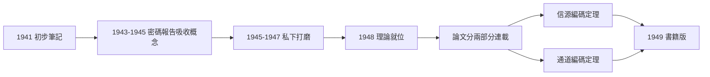
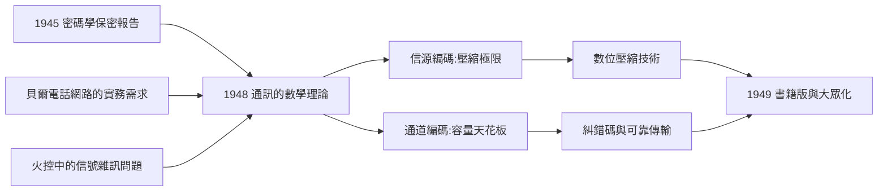

# 3.2 通訊的數學理論（1948）

1948 年 7 月與 10 月，香農在《貝爾系統技術期刊》（Bell System Technical Journal）分兩部分連載論文〈通訊的數學理論〉（A Mathematical Theory of Communication）。這篇論文為「資訊」給出了嚴格的數學定義，建立了一門新科學，並在十年內改寫了通訊、電腦、語言學、生物學乃至物理學。史家把它與 1687 年牛頓《原理》、1859 年達爾文《物種起源》並列為單篇論文改變世界的案例。

## 七年的沉默與一次爆發

從 1941 年的初步筆記到 1948 年的論文，香農讓這個問題「發酵」了七年：

- 同事們都知道「香農在搞通訊理論」，但他極少透露內容；
- 1945 年的密碼報告已是半成品，他卻按住不發——因為他覺得理論「還不夠乾淨」；
- 1948 年春天，他終於感覺所有拼圖就位：熵的公理化證明完成、通道編碼定理證明完成、隨機過程建模成熟；
- 論文一氣呵成，數學乾淨得「像牛頓」——同行形容讀它像「看一座突然出現的完整建築，卻看不到施工鷹架」。

這種「憋大招」的風格是他終身的標籤：極少預告、極少中間報告、出手即成品。它保證了品質，也偶爾讓他錯失先機（見 4.3 的投資理論與 5.1 的雜耍機器人，都有同樣的「藏了十年」現象）。

## 三個根本動作

### 一、剝離「意義」

香農做了讓所有人意外的第一步：**資訊理論與語義無關**。他研究的不是訊息「說什麼」，而是訊息如何被表示、傳輸與還原。這個「降維」動作使數學處理成為可能——正如牛頓不問行星「為何」運動而只寫下方程。

### 二、把信源看作隨機過程

信源（一段文字、語音、影像）被建模為隨機過程。香農以英文文本為例：字母出現有統計規律，他甚至用蒙特卡羅式的一階、二階、三階近似產生「假英文」，直觀展示了統計結構與可壓縮性的關係——這也是隨機模擬方法的早期示範。

### 三、定義資訊的度量：熵

$$H(X) = -\sum_i p_i \log_2 p_i$$

熵度量一個信源的平均不確定性，單位是「位元」（bit，二進位數字，此詞由圖靈同事圖基 John Tukey 建議、香農採用）。它是壓縮的極限、傳輸的代價、也是後來遍及各學科的通用貨幣。

## 四大定理

| 定理 | 內容 | 意義 |
|------|------|------|
| 無失真信源編碼定理 | 任何信源都可以壓縮到熵 $H$ 附近，但不可能低於 $H$ | 壓縮的極限（ZIP、MP3 的理論基礎） |
| 通道編碼定理 | 存在編碼方式，使傳輸錯誤率可任意小，速率逼近通道容量 $C$ | 可靠通訊不必犧牲速度——反直覺的奇蹟 |
| 通道容量公式 | $C = B \log_2(1 + S/N)$（頻寬 $B$、訊雜比 $S/N$） | 給出任何通道的速率天花板 |
| 連續信源編碼定理 | 量化與失真率理論的起點 | 數位化音訊視訊的依據 |

通道容量公式是工程史上最優美的結果之一：只要速率低於 $C=\max_{p(x)} I(X;Y)$（$I(X;Y)$ 為輸入輸出的互資訊），就**存在**碼能讓錯誤率趨近零——哪怕通道很吵。1948 年之前，工程師以為「降雜訊」唯一的方法是加大功率或重傳；香農證明：用聰明的編碼，錯誤與速率可以同時馴服。

### 一個直觀的比喻

把通道想像成一條嘈雜的走廊，你想隔著人群喊話：

- **笨辦法**：越喊越大聲（加大功率）、重複三遍（重傳）——費力且仍有上限；
- **香農辦法**：與對方事先約定一套「超級冗餘但精心設計」的語言（編碼），使任何零星誤聽都能被整句上下文糾正；
- 只要語言的冗餘設計得當（低於容量 $C$），走廊再吵，誤解率也能壓到任意低；
- 驚人之處在於：這不是工程直覺，而是**被嚴格證明的數學定理**——而且證明用的是機率論中的「典型序列」與隨機碼技巧，此後成為整個資訊理論的標準武器。

## 論文的結構之美

原論文的章節安排本身就是一份教學設計：

| 章 | 內容 | 現代對應 |
|----|------|----------|
| 1 | 離散無雜訊信源 | 信源熵與馬可夫鏈 |
| 2 | 離散無雜訊通道 | 等價電路與延遲 |
| 3 | 雜訊影響的數學化 | 互資訊 $I(X;Y)$ |
| 4 | 連續信源 | 微分熵 |
| 5 | 連續通道（AWGN） | 容量公式 $C=B\log_2(1+S/N)$ |

從離散到連續、從無雜訊到有雜訊，每一步都「先搭腳手架再上樓」。這種寫法使論文在七十年後仍可作為研究生教材的第一冊——多數劃時代論文做不到這一點。

## 學界的第一反應

- 論文發表後最初一兩年，反應相對克制——它太抽象，工程師一時不知如何「用」；
- 但馮紐曼一眼看出其分量。傳說中他曾建議香農：「你就叫它**熵**吧——第一，這個函數已經以同一名字出現在統計力學中；第二，沒有人真的懂熵，所以在辯論中你永遠占上風。」（→ 詳見《馮紐曼傳記》第 5 章）馮紐曼隨後親自安排香農與頂尖數學家交流；
- 1949 年，魏佛（Warren Weaver）撰寫面向外行的導論，與香農論文合併出版為《通訊的數學理論》單行本——這本書讓資訊論破圈（見 3.3）。

### 為什麼工程師一開始看不懂

論文的冷啟動期有具體的技術原因：

- 它用機率測度、隨機過程與遍歷理論的語言，而當年多數通訊工程師的數學工具箱裡只有傅立葉分析；
- 它的結論是「存在性」的（好碼存在），沒有附帶可用的碼——工程師要的是電路圖，得到的是定理；
- 它的術語是全新的：熵、位元、冗餘度、互資訊——每個詞都需要重新學習；
- 直到漢明碼（1950）給出第一個構造性兌現（見 3.3），工程界才真正「看見」定理的力量。

這段延遲是所有深理論的宿命：**改寫世界觀的論文，需要先等待世界換眼鏡**。

## 事件關聯與前因後果

| 年份 | 事件 | 與 1948 論文的關係 |
|------|------|--------------------|
| 1854 | 布林代數 | 「位元」的代數基礎（→ 詳見《布林傳記》） |
| 1937–1938 | 開關電路論文 | 位元的物理載體（見 2.1–2.2） |
| 1943 | 圖靈會面 | 共享計算與通訊的觀念（見 3.1） |
| 1945 | 密碼學報告 | 熵與完美保密的原型（見 3.1） |
| 1948 | 本論文 | 資訊論誕生 |
| 1949 | 書籍版出版 | 大眾化與跨學科擴散（見 3.3） |
| 1956 | 達特茅斯會議 | 資訊論語彙進入 AI（見 4.2） |

**因果**：1948 年論文是香農前十年所有經歷的「匯流口」——繼電器給了位元，密碼學給了熵與完美保密，火控給了雜訊問題，貝爾的電話網路給了應用場景。而它也是後五十年所有數位技術的「分水口」：壓縮、糾錯、加密、調變，全部在它的陰影下展開。

## 小結

- 1948 年完成了「資訊的公理化」：無意義的位元、統計的信源、可計算的容量上限；
- 通道編碼定理是最反直覺也最深刻的一環：**雜訊不再是敵人，而是可被編碼馴服的對象**；
- 1949 年，熵這個詞將走出貝爾實驗室，掀起一場席捲所有學科的革命（見 3.3）。
