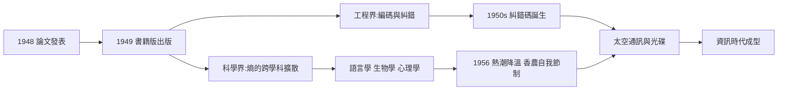

# 3.3 熵與位元革命（1949）

1949 年，伊利諾大學出版社推出《通訊的數學理論》單行本：香農的兩篇論文，加上魏佛（Warren Weaver）專為非技術讀者寫的長篇導論。魏佛把香農的數學翻譯成所有人都能感受的圖景——「你說的」與「他理解的」之間的鴻溝，如何被三個層次（技術、語義、效用）切分，而香農解決的正是最底層。這本薄薄的小書，把熵與位元推上了二十世紀下半葉最熱門的觀念舞台。

## 熵：從熱力學到資訊

香農的熵與玻茲曼的統計熵形式相同：

$$H(X) = -\sum_i p_i \log_2 p_i \qquad\longleftrightarrow\qquad S = -k\sum_i p_i \ln p_i$$

這不是巧合而是深層同構：**兩者都在度量「微觀不確定性」**。馮紐曼建議使用「熵」之名，使資訊論一出生就帶有物理學的血統（→ 詳見《馮紐曼傳記》第 5 章）。此後「資訊是物理的」這一命題——從蘭道爾（R. Landauer）1961 年的「資訊擦除有能耗下限 $kT\ln 2$」到今天的量子資訊理論——都是 1949 年這次合流的後裔。

### 熵的四條公理：為什麼只能是這個形式

香農在論文中不是「提出」熵，而是**證明**它是唯一合理的度量——任何滿足以下直覺條件的函數 $H$ 都必然取此形式：

1. **連續性**：機率的微小變化只引起 $H$ 的微小變化；
2. **單調性**：等機率事件的數量越多，不確定性越大；
3. **可分解性**（遞推）：先得知一部分訊息再得知其餘，總不確定性的加權和不變；
4. **極值性**：等機率時 $H$ 最大（最不可預測），確定時 $H = 0$。

這個「公理化—唯一性證明」的結構，正是他從《幾何原本》（見 1.1）與《數學原理》（→ 詳見《羅素傳記》第 2 章）繼承的方法論：不問「熵是什麼」，只問「什麼樣的函數配當度量」。證明一出，爭論即終——這是 1949 年革命最徹底的地方。

## 位元：新的通用度量衡

魏佛的導論之所以成功，在於他把一個技術理論放進了每個人都懂的框架——**通訊的三個層次**：

| 層次 | 問題 | 誰來解 |
|------|------|--------|
| A 技術層 | 符號如何準確傳輸？ | 香農（已解決） |
| B 語義層 | 符號傳達什麼意義？ | 語言學、哲學 |
| C 效用層 | 意義如何轉化為行動？ | 心理學、社會學 |

魏佛的天才在於指出：三層互相獨立，但 A 層的解決為 B、C 層**騰清了地基**。這個框架讓哲學家與工程師第一次可以在同一張桌上討論「資訊」，也解釋了為何本書能同時進入工程書架與人文書架。

「bit」成為整個數位世界的通用貨幣：

- 一幅黑白照片、一段英文句子、一次 DNA 鹼基、一個量子態——都可以用位元計價；
- 英文的統計冗餘度約 75%，意味著理論上可壓縮四倍——香農用「猜字遊戲」（Shannon game）讓實驗者逐字猜英文，實測出每個字母約 1.3 位元的熵；
- 這些度量直接指導了後來的哈夫曼編碼（1952）、算術編碼、以及一切壓縮格式。

### 猜字遊戲：最經濟的實驗

1951 年，香農在論文〈印英語的預測與熵〉（Prediction and Entropy of Printed English）中報告了這個天才級的實驗設計：

- 受試者看到一段英文的前文，逐字猜下一個字母，猜錯再猜，直到猜中；
- 猜中所需次數的分佈，直接反映該字母的**條件機率**；
- 實驗只需紙筆與耐心，卻精確測出了人類語言的統計結構：每字母約 0.6–1.3 位元（視前文長短）；
- 對照理論上限（26 個字母等機率時 $\log_2 26 \approx 4.7$ 位元），英文的冗餘度驚人地高——正是這些冗餘，讓我們能在嘈雜環境中讀懂殘缺的句子。

順帶一提，這個實驗與圖靈 1950 年的「模仿遊戲」在同一時空誕生（→ 詳見《圖靈傳記》第 5 章）：兩位好友各自設計了一個「遊戲」，把不可捉摸的對象（智能／資訊）化為可測量的行為。**把形上問題化為遊戲**，是 1940 年代那一代天才共有的方法論簽名。

## 跨學科的狂潮與香農的自我節制

1949–1953 年間，資訊論出現了史無前例的跨學科擴散：

- **語言學**：喬姆斯基受其啟發研究語言的統計模型（其 1951 年論文即以資訊論為工具）；
- **心理學**：米勒（George Miller）的神奇數字 $7\pm2$、麥凱（Donald MacKay）的資訊哲學；
- **生物學**：遺傳密碼開始被視為「訊息」——蓋莫夫、克里克等人的思考都借用了資訊論語彙；
- **經濟與社會科學**：各種「系統論」運動把熵當萬能鑰匙。

面對這股熱潮，香農的態度在科學史上極為罕見——**主動踩煞車**。1956 年他在 IRE Transactions 上發表〈給資訊論熱衷者的備忘錄〉（The Bandwagon），直言：資訊論並非萬靈丹，在其他領域的應用多半只是「搬弄術語」，呼籲大家回到嚴格的數學工作中。這份自省使資訊論免於變成空洞的口號，反而鞏固了它在通訊與計算中的核心地位。

## 糾錯碼：定理的第一次兌現

香農只證明了「好碼存在」，沒有給出構造。1950 年，漢明（Richard Hamming）在貝爾實驗室發表漢明碼——第一個實用的糾錯碼；隨後 Golay 碼、BCH 碼、Reed-Solomon 碼相繼問世。1970 年代的深空探測（水手號、航海家號）靠糾錯碼從數億公里外傳回影像；今天的光碟、SSD、5G，全都運行在香農定理的允許區間內。定理由此完成「存在性證明 → 實用構造 → 產業基礎設施」的三級跳。

## 關鍵年表

| 年份 | 事件 | 後續影響 |
|------|------|----------|
| 1948 | 〈通訊的數學理論〉 | 資訊論誕生（見 3.2） |
| 1949 | 書籍版出版；〈密碼學的數學理論〉解密發表 | 大眾化＋密碼學數學化 |
| 1950 | 漢明碼 | 香農定理的第一次工程兌現 |
| 1951 | 猜字遊戲論文 | 英文熵的實測 |
| 1951–1953 | 語言學、心理學、生物學全面引用 | 「資訊」成為時代關鍵詞 |
| 1952 | 哈夫曼編碼 | 信源編碼定理的教學級兌現 |
| 1956 | 〈給資訊論熱衷者的備忘錄〉 | 香農親自為熱潮降溫 |
| 1961 | 蘭道爾原理 | 資訊與物理的深度融合 |

## 擴散浪潮中的具體身影

「跨學科擴散」不只是現象描述，每個學科都有具體的受惠者：

| 學科 | 人物 | 借用內容 |
|------|------|----------|
| 語言學 | 喬姆斯基 | 馬可夫模型的不足催生轉換語法（→ 他的 1951 年論文直接以資訊論為工具） |
| 心理學 | 米勒 | 「神奇數字 $7\pm2$」：工作記憶的容量即通道容量 |
| 生物學 | 蓋莫夫、克里克 | 遺傳密碼＝4 元字母的編碼問題 |
| 物理學 | 布里淵 | 《科學與資訊理論》（1956）：熵的統一視角 |
| 經濟學 | 凱利 | 資訊率與最優賭注（見 4.3） |

有趣的是，這份名單上很多人**並未真正使用香農的定理**，只是借用了他的詞彙與世界觀——這正是香農在 1956 年踩煞車的原因（見下節），也是思想史上的永恆難題：一個概念一旦「破圈」，就無法收回。

## 1956 年的剎車：一封罕見的自我批評

1956 年 4 月，香農在 IRE Transactions on Information Theory 發表〈給資訊論熱衷者的備忘錄〉（The Bandwagon）。開頭一段直言不諱：

> 「我們這門新學科的聲望，正被一些模糊的相似性牽著走進與它關係不大的領域……我希望指出，這種做法是危險的。」

他接著列出了三條「健康使用的條件」：

1. **新問題要有實質的數學核心**，而非僅是術語的裝點；
2. **不能因為套用了熵一詞就宣稱深刻**——名詞不是證明；
3. **各學科應發展自己的「香農式」理論**，而非直接搬運。

在學術史上，創始人親手為自己引發的熱潮潑冷水，是極罕見的事件。多數學者的本能是擴大地盤；香農的本能是保衛嚴格性。這份備忘錄的效果立竿見影：空洞的跟風論文迅速退潮，資訊論反而因為「少而精」的聲譽更加穩固。二十年後，當資訊論在通訊工程中成為支柱時，人們回頭佩服的正是這一腳剎車。

**因果**：1949 年是資訊理論從「貝爾實驗室論文」變成「世界性觀念」的一年。魏佛的導論給了它通俗的翅膀，馮紐曼的人脈給了它數學的桂冠，「熵」之名給了它物理學的威望。而香農在 1956 年的踩煞車，則證明他既是這門科學的父親，也是最誠實的守門人。

## 小結

- 熵與位元在 1949 年完成「合流與命名」，資訊正式成為可度量的物理量；
- 香農不是提出熵，而是證明它是唯一的合理度量——公理化方法終結了爭論；
- 猜字遊戲示範了「把形上問題化為遊戲」的方法論，與圖靈測試互為姊妹篇；
- 香農的科學作風在同年代樹立典範：大膽公理化、嚴格證明、以及對濫用的公開抵制；
- 接下來，這位給出「思想極限」的人，開始把注意力轉向另一個方向——**讓機器自己學習與玩耍**（見第 4 章）。
