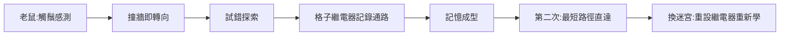

# 4.1 迷宮老鼠 Theseus（1950）

1950 年，香農在貝爾實驗室的實驗室裡造出了一隻金屬老鼠。牠沒有腦，只有兩輪車、磁鐵與繼電器電路；牠的家是一座 5×5 的木格迷宮。香農為牠取名 Theseus（忒修斯）——希臘神話中走出米諾斯迷宮的英雄。這隻老鼠展示了一個在當時石破天驚的觀念：**機器可以從經驗中學習**。

## 這隻老鼠能做什麼

Theseus 的展示流程令人著迷：

1. 被放進迷宮後，Theseus 以試錯方式亂撞探索，撞牆就轉向；
2. 每通過一個格子，迷宮下方的繼電器陣列就「記住」該格與相鄰格的通路關係；
3. 任何一條走通的路線，第二次走時 Theseus 就能**直接沿最短路徑直達**；
4. 香農還能改變迷宮牆壁位置——重設繼電器，老鼠「重新學習」。

用今日語言說，Theseus 是一個**帶記憶的強化學習代理**：環境（迷宮）、感知（觸鬚開關）、行動（兩輪車）、記憶（繼電器狀態矩陣）、學習（探索後的路徑更新）五要素俱全。牠的「腦」約由 75 個繼電器構成，而當時最先進的通用電腦 ENIAC 用掉一萬八千支真空管（→ 詳見《馮紐曼傳記》第 4 章）。

### 機器的解剖學

Theseus 的巧妙之處在於**把記憶放在迷宮裡而非老鼠裡**：

- 迷宮每個格子下方有一組繼電器，記錄「本格與四面鄰格是否可通」；
- 老鼠底部的磁鐵與線圈充當「讀寫頭」：經過某格時，機械裝置更新該格記憶；
- 尋路時，繼電器網路以「接力」方式把最短路徑的指令沿格子傳遞，引導老鼠；
- 這種「環境即記憶」的設計，與今日機器人學中的「標記場」、乃至昆蟲學家發現的螞蟻信息素路徑驚人地相似——香農 1950 年就想到分佈式記憶。

按現代術語，這是一個 **Tabular Q-learning 的硬件實現**（獎勵＝到達目標，更新＝路徑記錄），早於薩頓與巴圖的強化學習理論三十餘年。

### 展示與傳播

Theseus 很快走出實驗室，成為貝爾實驗室的「外交官」：

- 1950 年代初被拍成教學影片，在全美的工程師培訓與大學巡迴放映；
- 《生活》（Life）雜誌為牠拍攝了專題照片——一隻金屬老鼠的特寫占滿一整頁；
- 香農親自講解時總強調重點：「**牠沒有被編程走任何路線。牠是自己學會的。**」
- 觀眾的反應分兩派：驚嘆派（「機器在思考！」）與懷疑派（「不過是繼電器記錄罷了」）——這場爭論預演了日後所有 AI 世代的「智能 vs 自動」辯論。

## 為什麼香農要做牠

- **理論動機**：1948 年的資訊理論處理「傳輸」，但香農一直想追問「處理」——資訊如何被用來行為與學習？這正是 1943 年與圖靈對談的延續（見 3.1）；
- **實作動機**：1949 年他發表〈計算機的繼電器電路分析〉，把序向電路（帶記憶的電路）理論化——Theseus 正是這套理論的實體教科書；
- **示範動機**：他想讓公眾看到，學習不是神秘的心靈現象，而是**可以用開關電路實現的資訊過程**。

### 名字的深意

把老鼠命名為忒修斯，不是隨手拈來：

- 希臘神話中，忒修斯靠著阿里阿德涅的線團走出迷宮——**線團是外部記憶**；
- 香農的老鼠同樣依賴迷宮裡的繼電器「線團」——這個命名本身就是設計說明書；
- 神話的深層主題是「用記號戰勝混沌」，這正是整個資訊時代的主題；
- 香農一生給機器起名都帶著這種幽默：THROBAC、終極機器、以及他自稱的各種怪名——名字是理解他機器的第一把鑰匙（見 5.1）。

## 撥動時代的兩篇 1950

1950 年前後，機器智能的第一波浪潮由幾份文獻共同掀起：

| 年份 | 作品 | 作者 | 主張 |
|------|------|------|------|
| 1949 | 《計算機器與智能》書籍版 | 傑佛森等 | — |
| 1950 | 〈計算機器與智能〉論文 | 圖靈 | 提出模仿遊戲，即圖靈測試（→ 詳見《圖靈傳記》第 5 章） |
| 1950 | Theseus 演示 | 香農 | 機器可在真實環境中學習 |
| 1950 | 〈下棋程式〉論文 | 香農 | 見 4.2 |

圖靈與香農不約而同選擇了「演示」而非「論證」：一個提出測試，一個造出機器。兩人共同的敵人是「機器只是工具、不可能有智能」的直覺偏見。

## 事件關聯與前因後果

| 年份 | 事件 | 與 Theseus 的關係 |
|------|------|-------------------|
| 1943 | 與圖靈談「機器思考」 | 思想種子（見 3.1） |
| 1948 | 資訊理論 | 「學習即資訊處理」的理論基礎（見 3.2） |
| 1949 | 序向電路論文 | 記憶電路的數學工具 |
| 1950 | Theseus 問世 | 機器學習的早期實體證明 |
| 1956 | 達特茅斯會議 | 香農攜這些工作參與 AI 命名（見 4.2） |
| 1980s | 強化學習正式成形 | 薩頓等人把試錯學習數學化 |

**因果**：Theseus 不是玩具，而是論證。它把三條線——布林的開關電路、香農的資訊理論、圖靈的機器智能——焊成一臺會學習的機器。三十年後的強化學習、機器人自主導航（SLAM 的精神原型）、乃至今天的掃地機器人，都是這隻金屬老鼠的直系後代。

## 小結

- Theseus 以 75 個繼電器示範了「探索—記憶—利用」的學習迴路；
- 它標誌著香農從「資訊的理論家」轉身成為「機器智能的造物者」；
- 同一年，他還寫下了機器下棋的開創性論文——遊戲將成為 AI 的第一個實驗場（見 4.2）。
