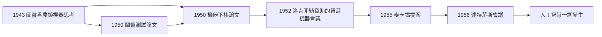

# 4.2 機器下棋與達特茅斯會議（1950–1956）

1950 年，香農發表論文〈為計算機編程以 下棋〉（Programming a Computer for Playing Chess）——這是史上第一篇系統論述機器下棋的論文，比圖靈的棋類程式構想更具工程細節。六年後的 1956 年夏天，他成為達特茅斯會議的共同發起人——「人工智慧」一詞在此誕生。這六個年頭，是香農親手把資訊理論的火種，移植進新興的機器智能運動。

## 1950：下棋作為「智能的果蠅」

香農選擇下棋的理由，後來被遺傳學家穆勒的比喻反襯而廣為流傳——下棋是**智能研究的果蠅**（遺傳學家用果蠅做實驗，因為它便宜、快、可觀察）：

- 規則完全明確、搜索空間巨大（約 $10^{120}$ 種局面）、評估直觀；
- 論文提出了完整的程式架構，其中的名詞至今仍在使用：
  - **搜尋樹**與**極大極小演算法**（minimax）；
  - **位置評估函數**（材料、機動性、王的安全……的加權）；
  - **α-β 剪枝**的思想先驅；
  - 論文還證明了局限：暴力搜索無法戰勝人類，必須依賴評估與剪枝——這個判斷引導了之後四十年的電腦象棋；
- 他估計，按當時的技術，一台每秒百萬次的機器也「最多達到業餘水準」——嚴謹的預測，而深藍 1997 年擊敗卡斯帕羅夫時，靠的正是算力成長一百萬倍＋評估函數＋剪枝的組合。

## 從洛克菲勒會議到達特茅斯

1955 年，年輕的數學家約翰·麥卡錫（John McCarthy）決定發起一個「夏季研究計畫」，研究「基於『學習』或『智能』任何特徵的猜想，可被機器精確描述的每一個面向」（→ 詳見《麥卡錫傳記》第 2 章）。他拉起了一個黃金陣容的發起人名單：

- **香農**（貝爾實驗室）：資訊理論之父，學界的超級品牌；
- **麥卡錫**（達特茅斯）：提案主筆；
- **明斯基**（哈佛）：年輕的神經網路批評者，日後的 AI 大師；
- **羅徹斯特**（IBM）：701 電腦總設計師，提供產業後盾。

1956 年 6 月至 8 月，會議在新罕布什爾州漢諾瓦的達特茅斯學院舉行。與會者包括麥卡錫、明斯基、香農、紐厄爾、西蒙、薩繆爾（塞繆爾的西洋跳棋程式正在此期間演示自我學習）等。**「Artificial Intelligence」一詞由麥卡錫定下**，會議成為這門學科的正式誕生地。

## 香農在其中的獨特角色

- 他是會議中**唯一**已經擁有兩門奠基性理論（開關電路、資訊理論）的人；
- 他帶去了下棋論文與 Theseus 的經驗，把「搜索＋學習」的範式正式帶入會議議程；
- 會後他與明斯基合編文集《自動機研究》（Automata Studies, 1956），把圖靈機、神經網路與資訊論收進同一本文集——這本書是 AI 與可計算性理論的早期橋樑（→ 詳見《圖靈傳記》第 3 章）。

## 事件關聯與前因後果

| 年份 | 事件 | 後續影響 |
|------|------|----------|
| 1950 | 機器下棋論文 | 電腦象棋四十年的範式：搜索＋評估＋剪枝 |
| 1950 | Theseus 演示 | 學習機器的實體展示（見 4.1） |
| 1952 | 貝爾實驗室主辦智慧機器會議 | 美國 AI 運動的前哨 |
| 1955 | 麥卡錫起草達特茅斯提案 | 香農列入發起人 |
| 1956 夏 | 達特茅斯會議 | AI 學科誕生 |
| 1956 | 《自動機研究》文集 | AI 理論化的重要文獻 |
| 1997 | 深藍勝卡斯帕羅夫 | 香農 1950 框架的最終兌現 |

**因果**：達特茅斯會議之所以可能，前一半功勞屬於麥卡錫的組織才能，後一半屬於香農與圖靈在 1940 年代埋下的理論與示範。沒有 1950 年的棋類論文，「機器能展現智能」就只是哲學爭論；有了它與 Theseus，這變成了一個可操作的研究綱領。香農又一次扮演了「翻譯者」——這次是在數學與夢想之間。

## 小結

- 1950 年下棋論文確立了「搜索＋評估＋剪枝」的範式，1997 年深藍是它的畢業典禮；
- 1956 年達特茅斯會議上，香農以兩門理論創始人身分為 AI 背書，學科由此命名誕生；
- 1957 年起，香農離開貝爾實驗室回到母校 MIT 任教，資訊論開始向全世界輻射（見 4.3）。
