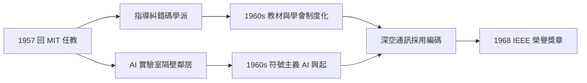

# 4.3 MIT 教授與資訊論擴散（1957–1972）

1956 年香農離開工作了十五年的貝爾實驗室，1957 年起以客座教授身分回到母校 MIT，1958 年正式受聘為電機工程教授（後兼任科學教授），1972 年成為榮譽教授。這十五年是他的「輻射期」：他不再以新理論震撼世界，而是以導師、評審與象徵的身分，把資訊論推向通訊工程的每個角落，也把 MIT 變成資訊科學的世界首都。

## 雙樓辦公室的教授

- 他的辦公室在電子研究實驗室（RLE）樓裡，隔壁就是將在 1960 年代崛起的 AI 實驗室（→ 詳見《麥卡錫傳記》第 3 章——麥卡錫與明斯基 1959 年在 MIT 建立了 AI 計畫，血統直接來自達特茅斯）；
- 他指導的博士生不多（前後十餘人），但個個位於關鍵崗位：如蓋拉格（Robert Gallager，日後的糾錯碼大師、《資訊理論與可靠通訊》作者）；
- 他的教學風格一如其人：課堂上拋雜耍球、展示機器人、用玩具講原理——學生回憶「他從不炫耀，只是問題想得太清楚」。

## 資訊論的工程制度化

1957–1972 年間，資訊論完成了從「一篇論文」到「工程學科」的三級跳：

| 年份 | 制度化事件 | 意義 |
|------|-----------|------|
| 1953 | IRE 專業組（PGIT）成立 | 資訊論有了自己的學會 |
| 1955 起 | IEEE 資訊論國際研討會（ISIT）年度化 | 學術共同體成型 |
| 1960s | NASA 深空通訊採用編碼理論 | 定理的太空兌現 |
| 1968 | IEEE 榮譽獎章 | 工程界的最高加冕 |

在此期間，香農的理論結出實果： Gallager 與沃茲克拉夫茲（Wozencraft）等人的教材把通道編碼定理寫成研究生必修；漢明碼之後的 BCH 碼、卷積碼進入太空任務——航海家號 1977 年升空時，其通訊鏈路的每個設計決策都要對照香農極限（見 5.2）。

## 研究上的「第二曲線」

香農本人此時的研究越發「離經叛道」而深邃：

- **投資組合理論**（1960s）：他把凱利公式（Kelly criterion, 1956，來自資訊率與賭博的類比）推廣到股市，與數學家索普（Edward Thorp）合作，用資訊論原理在二十一點與輪盤上「系統性獲利」，索普後來以此寫成《擊敗莊家》——資訊理論最戲劇性的應用之一；
- **資訊理論與自動機**：繼續深化圖靈機、有限自動機與語言的關係（與麥卡錫 1956 年合作的有限自動機論文是此方向經典，→ 詳見《麥卡錫傳記》第 2 章）；
- **雜耍的數學**（1967 前後）：他寫出雜耍的正式理論——以「空中球數 = 抛接手數 × 球的滯空循環」刻畫節奏，日後成為雜耍社群的經典模型（見 5.1）。

## 同時代座標：資訊論與計算機科學的分進合擊

| 人物 | 1957–1972 的動向 | 與香農的交會 |
|------|------------------|--------------|
| 馮紐曼 | 1957 年去世；其 EDVAC 報告定義了儲存程式架構 | 資訊論與電腦架構互為表裡（→ 詳見《馮紐曼傳記》第 5 章） |
| 圖靈 | 1954 年去世；圖靈獎 1966 年設立 | 每年圖靈獎得主與香農理論同框（→ 詳見《圖靈傳記》第 6 章） |
| 麥卡錫 | 1958 發明 LISP；1962 起 斯坦福 AI 實驗室 | 達特茅斯同盟（→ 詳見《麥卡錫傳記》第 3 章） |
| 布林 | 代數經香農工程化後成為硬體設計標準 | 每片晶片都是「布林的邏輯＋香農的位元」（→ 詳見《布林傳記》第 4 章） |

**因果**：MIT 時期的香農完成了「制度化接力」——理論由他和魏佛創立，由蓋拉格們寫成教材，由 IEEE 變成學會，由 NASA 變成太空船的天線。而他自己則轉身走向更自由的天地：賭場、股市、雜耍、獨輪車。這看似「不務正業」，實則是他一貫方法論的延伸：**在任何領域，先問資訊在哪裡、極限在哪裡**。

## 小結

- MIT 十五年，香農的主要作品是「人」與「制度」：學生、教材、學會；
- 資訊論在此完成工程化閉環，成為通訊工程的公理系；
- 1972 年之後，榮譽如潮水湧來，而他選擇以雜耍機器人與玩具實驗室迎接晚年（見 5.1）。
