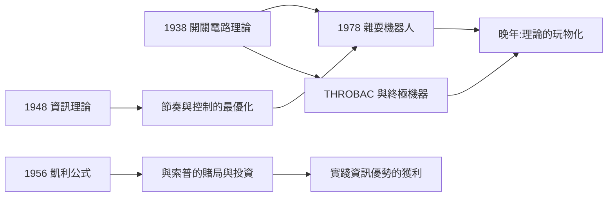

# 5.1 榮譽與雜耍機器人的晚年（1972–1985）

1972 年起，香農進入榮譽的收穫期，同時把住家變成了一座玩具宮殿。這個階段常被誤讀為「天才的退休」，但更準確的說法是：**他終於可以把一生的資訊論、開關電路與控制理論，全部用來做純粹好玩的事**——而這些玩具，依然是論證。

## 榮譽年表

| 年份 | 榮譽 | 意義 |
|------|------|------|
| 1966 | IEEE 榮譽獎章、國家科學獎章（由詹森總統頒發） | 資訊理論的雙重加冕 |
| 1972 | 貝爾實驗室研究員（Member of Staff, 最高技術職位） | 機構認可其終身貢獻 |
| 1978 | 京都獎首屆得主 | 國際性的跨界肯定 |
| 1985 | 日本國際獎 | 資訊時代的全球致敬 |
| 2000 | 入選國家發明家名人堂 | 與愛迪生同列——童年的偶像，晚年的同榜 |

## 玩具宮殿：Maze Works

香農在馬薩諸塞州溫徹斯特的家，地下室被稱為「Maze Works」，收藏著上百件自制機器：

- **終極機器**（Ultimate Machine）：一個盒子，打開開關，蓋子掀開，伸出一隻機械手「啪」地關掉開關，再縮回去——一臺只做一件事的機器，是關於「自動性」的哲學笑話；
- **THROBAC**：用羅馬數字做算術的計算機（THrifty ROman-numeral BAckward-looking Computer）——布林的邏輯與古典遺產的調侃式致敬；
- **雜耍機器人**（1978–1980 建成）：與索普合作構想、實際由機械工程實現的三球拋接機——沒有手，只有震動的鼓面；球落下被彈起，機器只需控制「何時彈」。它驗證了香農 1967 年的雜耍理論：**雜耍的本質是節奏與資訊，不是手臂的靈巧**；
- **獨輪車**：他自制過一輛只能倒騎的獨輪車與騎單輪走鋼索的機器人，拋球騎車穿過貝爾實驗室走廊是他留給同事的經典畫面；
- 與明斯基等友人往來的通訊中，玩具設計圖與數學推理穿插並列——對香農而言兩者毫無區別。

## 與索普的「資訊致富」實驗

1960 年代初，年輕數學家索普（Edward Thorp）寫出二十一點必勝策略，香農鼓勵他投稿並合作研製了**可穿戴的微型計算機**去拉斯維加斯賭輪盤——用腳趾按鍵輸入、耳機接收下注信號。這臺 1961 年的「穿戴式電腦」被視為量化投資與可穿戴計算的共同祖先；索普後來轉戰華爾街，創辦的普林斯頓—紐波特基金成為量化對沖基金的開山之作。香農本人則用凱利公式管理自家股票，收益長期跑贏大盤——資訊論在賭桌與市場上的雙重驗證。

## 晚年風格的意義

- 他拒絕了大多數學術行政職務，也極少撰寫綜述或回顧性文章；
- 1978 年京都獎演說中，他把自己的生涯歸結為一條原則：**「好奇心」優先於「有用性」**；
- 1985 年在國際資訊論研討會（Brighton）上，這位平日低調的大師在宴會中拋球雜耍、騎單輪車登場，與會者驚覺：資訊理論之父原來是一位雜耍博士——這一幕成為該學科史上的傳奇畫面。

**因果**：晚年的玩具不是離開科學，而是科學的純化形式。終極機器展示「自動」的荒誕本質，雜耍機器人驗證他的節奏理論，賭場與股市兌現他的資訊優勢公式。香農用餘生證明：當理論足夠深刻，玩耍就是研究。

## 小結

- 1972–1985 年，榮譽（IEEE 獎章、國家科學獎章、京都獎）與玩具（雜耍機器人、THROBAC、終極機器）同時到來；
- 與索普的穿戴式電腦開啟了量化交易與可穿戴計算兩條產業線；
- 而真實世界正在此時全面走進他的理論——數位化的世紀即將印證一切（見 5.2）。
