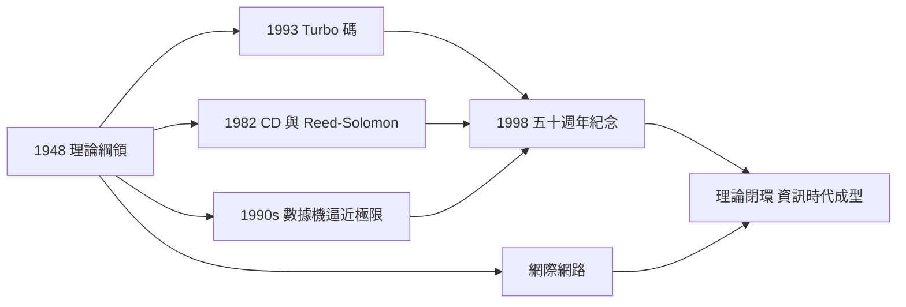

# 5.2 資訊時代的全面印證（1980–2000）

1980 到 2000 年的二十年，是香農理論的「總兌現期」。他一生只在貝爾實驗室與 MIT 的辦公室裡推導公式，而全世界則用光纖、衛星、光碟與網際網路，逐條驗證了他的定理。當 2000 年來臨，人們回頭看 1948 年的那篇論文，才發現它幾乎是一張**提前寫好的時代施工圖**。

## 逐條兌現的定理

| 香農定理／概念 | 1980–2000 的工程兌現 |
|----------------|----------------------|
| 信源編碼極限 $H$ | 哈夫曼與算術編碼→ ZIP、GIF、JPEG（1992）、MP3（1993） |
| 通道容量 $C=B\log_2(1+S/N)$ | 數據機從 1200 bps 爬升到 56K，逼近撥號通道極限 |
| 通道編碼定理 | 卷積碼＋Viterbi 解碼統治 CDMA 手機（1990s）；Turbo 碼（1993）達到距極限僅 0.5 dB |
| 糾錯碼 | Reed-Solomon 碼守護 CD（1982）、DVD 與深空探測 |
| 密碼學數學理論 | DES（1977）、RSA（1977）與現代密碼學全部以「計算不可區分」為綱——香農 1949 框架的直接延伸 |
| 位元作為通用度量 | 數位化席捲音訊、影像、通訊、出版——「位元」成為時代貨幣 |

1998 年，香農的 1948 論文發表五十週年，IEEE 與貝爾實驗室舉行盛大紀念；同年貝爾實驗室官員宣告：「我們今天所知的數位時代，整體上是他 1948 年論文的應用。」這不是修辭——是工程界的清算結論。

## Turbo 碼：最後一塊拼圖

1993 年，法國電信的 Berrou 等人發表 Turbo 碼：透過迭代軟解碼，實際傳輸速率達到香農極限的 98% 以上。六十五年來，工程師第一次把通道編碼定理從「存在性證明」變成「施工完成」。這標誌著資訊論的理論綱領基本閉環——2000 年後的 LDPC 復興、5G 極化碼，都在同一綱領內收尾。

## 網際網路：資訊論的社會化

1990 年代的全球資訊網把香農的抽象層次又推高一層：

- 網際網路的每一層——調變、信道編碼、資料壓縮、加密、擁塞控制——都直接呼叫資訊論的結論；
- 香農當年刻意剝離的「意義」，如今由萬維網的連結結構接手處理；「資訊的統計理論」與「資訊的社會理論」在 1990 年代交會；
- 1990 年代末，「資訊理論之父」的頭銜隨著 dot-com 熱潮傳遍大眾媒體——一位隱居在溫徹斯特玩雜耍的退休老先生，成了新經濟的守護神。

## 世紀末的致敬潮

- 1990 年代，傳記與紀念文集陸續出版，學界開始系統梳理他的遺產；
- 1998 年前後，他多次受訪，被問到為何當年能想出資訊理論，他的回答始終如一：「我只是想知道，通訊的本質是什麼。我把問題縮到最小——先不管意義。」；
- 2000 年，他入選國家發明家名人堂，與童年偶像愛迪生同列一榜——蓋洛德的電報男孩，走完了七十八年的直線。

## 事件關聯與前因後果

| 年份 | 事件 | 呼應 |
|------|------|------|
| 1982 | CD 問世 | Reed-Solomon 糾錯＋取樣定理 |
| 1990 | 萬維網構想 | 資訊的社會化 |
| 1993 | Turbo 碼 | 通道編碼定理的實用化 |
| 1997 | 深藍勝卡斯帕羅夫 | 1950 下棋框架兌現（見 4.2） |
| 1998 | 1948 論文五十週年 | 學界的總結算 |
| 2000 | 發明家名人堂 | 與愛迪生同榜（見 1.1） |

**因果**：這二十年證明了一件事——理論可以先行半個世紀。1948 年的每一條公式，在 1980–2000 年逐一被轉化為產品與產業；而當年香農「踩煞車」守住的嚴格性（見 3.3），正是這些兌現得以嚴絲合縫的原因。剩下的最後一件事，是歷史為這位一生低調的工程師哲學家舉行謝幕式（見 5.3）。

## 小結

- 1980–2000 年，資訊論的四大支柱（壓縮、容量、糾錯、保密）全部工程化並成為基礎設施；
- Turbo 碼與深空通訊把「香農極限」從天花板變成日常工作區；
- 二十世紀落幕時，資訊時代的全套圖紙已經驗收完畢——2001 年，圖紙的作者離場（見 5.3）。
