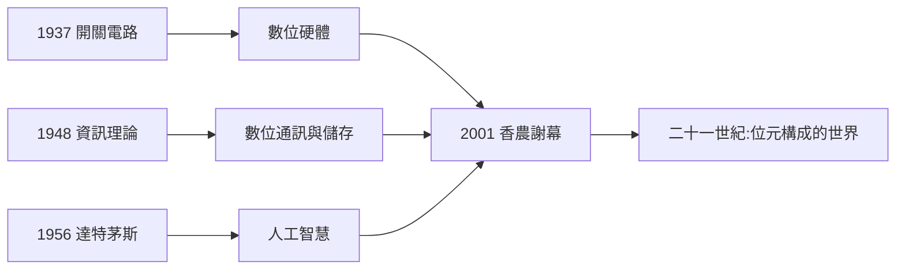

# 5.3 去世與遺產（2001）

2001 年 2 月 24 日，克勞德·香農在馬薩諸塞州麥德福的一家療養院去世，享年八十四歲。晚年他與阿茲海默症共處多年——一位畢生研究「資訊的保存與傳遞」的人，最後在記憶的流失中離去；而他的遺產，則正在地球上以每秒數十億位元的速度增殖。太太瑪麗（Mary Elizabeth Moore Shannon，1949 年結婚）與三名子女在側。

## 謝幕的安排

- 訃聞由《紐約時報》以頭版外的重要版面發布，全球主要媒體一致以「資訊時代之父」「數位時代的牛頓」稱之；
- 貝爾實驗室（時屬朗訊科技）與 IEEE 分別發表悼文，將 1948 論文定位為「二十世紀最重要的單篇工程文獻」；
- 按其低調遺風，家屬未舉行大型公開葬禮；學界的紀念以 2002 年前後的多場研討會與專刊延續。

## 遺產的總盤點

香農一生正式發表的論文不到百篇，卻開創了三門學科：

1. **數位電路理論**（1937–1938）：布林代數的工程化——所有晶片的設計語言（→ 詳見《布林傳記》第 4 章）；
2. **資訊論**（1945–1949）：熵、位元、通道容量、完美保密——所有數位通訊與儲存的公理系；
3. **機器智能的先驅工作**（1950–1956）：Theseus、下棋論文、達特茅斯會議——AI 學科的命名與誕生（→ 詳見《麥卡錫傳記》第 2 章）。

以單一學者而論，這份清單在二十世紀幾無對手。而他的方法論本身，是第四項遺產：

- **把問題剝到最小**：先放下意義，只看統計；
- **理論與玩具不分**：微分分析儀、繼電器老鼠、雜耍機器，都是論證；
- **誠實剎車**：1956 年的「備忘錄」示範了創造者如何守住自己學科的嚴格性。

## 與同代人構成的世紀圖譜

香農的離世，標誌著一整代「奠基者」時代的終結：

| 人物 | 生卒 | 奠基領域 | 與香農的關係 |
|------|------|----------|--------------|
| 圖靈 | 1912–1954 | 可計算性、AI | 1943 會面的思想伙伴（→ 詳見《圖靈傳記》第 5、6 章） |
| 馮紐曼 | 1903–1957 | 儲存程式架構、賽局論 | 資訊理論的頭號推手（→ 詳見《馮紐曼傳記》第 5 章） |
| 麥卡錫 | 1927–2011 | AI 命名與 LISP | 達特茅斯的發起同盟（→ 詳見《麥卡錫傳記》第 3 章） |
| 布林 | 1815–1864 | 邏輯代數 | 被香農「工程化」的先賢（→ 詳見《布林傳記》第 4 章） |

他們串起一條完整的鏈：布林的邏輯 → 圖靈的可計算性 → 馮紐曼的架構 → 香農的資訊 → 麥卡錫的智能。二十一世紀的每一項數位技術，都是這條鏈的下游。

## 紀念的延續

- IEEE 資訊論學會設有**香農講座**（Shannon Lecture）與香農獎，為該領域最高榮譽；
- 貝爾實驗室、MIT、密西根大學與貝爾實驗室基金設有以他命名的講席與中心；2016 年百歲誕辰，IEEE 與各地機構舉辦「香農百年」全球紀念；
- 2017 年傳記《A Mind at Play》出版，把蓋洛德的電報男孩完整介紹給新一代讀者；
- 學界最常用的致意方式仍是一句樸素的話：**「你現在讀到這行字的方式，就是香農的遺產。」**

## 關鍵年表（終章）

| 年份 | 事件 |
|------|------|
| 2001.2.24 | 於麥德福去世，享年 84 歲 |
| 2002 | 學界系列紀念研討會 |
| 2016 | 百歲誕辰「Shannon Centennial」全球紀念 |
| 2020s | 5G、量子通訊、生成式 AI——全部運行在 1948 年的理論框架之內 |

**因果**：香農的一生完成了一個近乎完美的閉環——蓋洛德的自制電報機（1932 前）傳送的是摩斯電碼的位元；八十年後，人類文明的全部記憶，都以同樣的位元在光纖與衛星中流動。他二十歲時玩過的兩樣東西——**開關**與**電碼**——合起來恰好就是數位文明。1998 年有人問他資訊時代的感受，他答得像個蓋洛德男孩：「我當初只是想知道，一條電話線究竟能傳多少東西。」

## 小結

- 2001 年謝幕時，香農的三門遺產（數位電路、資訊理論、AI 先驅）已全部成為文明基礎設施；
- 他的方法論——極小化問題、理論即玩具、誠實剎車——是給後世科學家的第四份遺產；
- 本傳記的結尾也是一個起點：只要人類仍在傳送位元，1916 年蓋洛德出生的那個孩子就仍在場。
