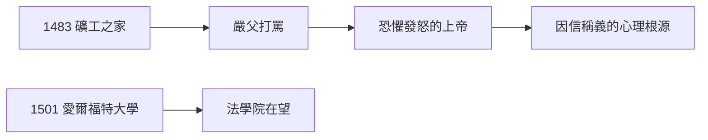

# 1.1 出生（1483）

1483 年 11 月 10 日，馬丁·路德（Martin Luther）出生於薩克森艾斯萊本，父親是銅礦礦主（從農民奮鬥上來的暴發戶），母親嚴厲虔誠。父親對他期望極高：讀法律、當律師、光宗耀祖——為此不惜重金送他上學。

## 嚴父的烙印

- 父親動輒打罵，路德晚年回憶「一次重打讓我至死難忘」；
- 嚴父形象投射到上帝身上：他終身恐懼一位「發怒的上帝」，這是因信稱義（2.2）的心理根源；
- 1501 年入愛爾福特大學，1505 年獲碩士，法學院在望——父親的劇本眼看實現。

## 礦工之子的階級

路德不是貴族，不是教士，是第一代知識分子。他的德文寫作（4.2）帶著民間的粗糲與力量——罵教皇的話，礦工聽得懂。

**因果**：嚴父製造了恐懼，恐懼製造了神學問題（人如何得救），神學問題製造了宗教改革。下一節，一場雷雨改寫劇本。
