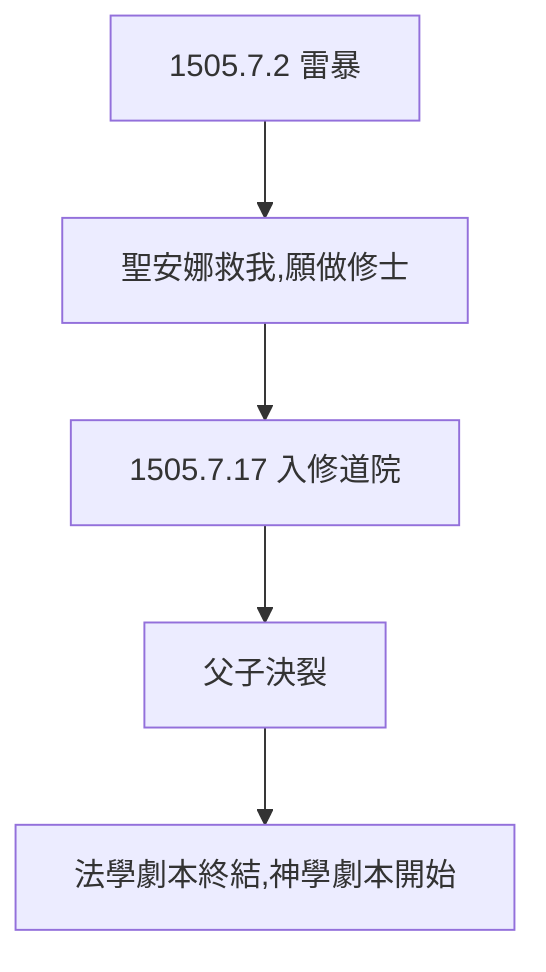

# 1.2 雷擊誓言（1505）

## 1505 年 7 月 2 日：施托特恩海姆

21 歲的路德從父母家返校途中遭遇雷暴，一道閃電劈在身邊。他撲倒在泥裡大喊：「聖安娜救我，我願做修士！」（Heilige Anna, hilf! Ich will ein Mönch werden!）——向父親劇本的決裂，只用了一道閃電。

## 父親的暴怒

父親聞訊大怒：「這是魔鬼的伎倆！」斷絕經濟往來。父子關係至此破裂，多年後才和解（父親臨終前，路德去床前盡孝）。

## 誓言的重量

- 中世紀人相信誓言的絕對約束力，路德 1505 年 7 月 17 日真的進入奧古斯丁修道院；
- 後人考證：雷擊可能是他早已厭倦法學的藉口——但藉口一旦出口，就成了命運；
- 一道閃電，劈開了歐洲歷史。

**因果**：嚴父的期望（1.1）被一道閃電終結。雷擊是偶然，厭倦法學是必然——偶然成了必然的出口。下一節，修道院。
