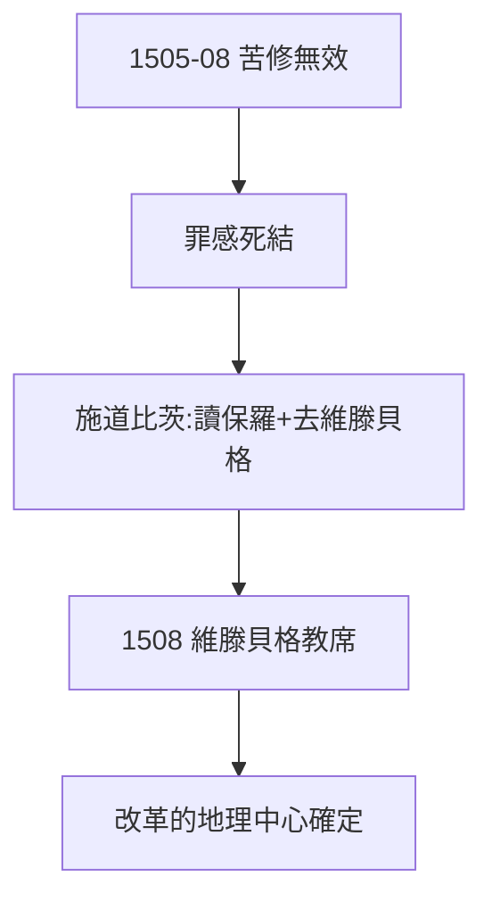

# 1.3 奧古斯丁修道院（1505–1508）

## 苦修的模範生

路德是修道院最嚴格的修士：徹夜祈禱、頻繁告解（同一罪告解數小時，神父不耐煩）、禁食到暈倒。他想用苦修馴服「發怒的上帝」（1.1），結果越修越絕望——罪感如影隨形。

## 施道比茨的開導

修道院長施道比茨（Staupitz）看出他的死結，說了兩句改變歷史的話：

1. 「去讀保羅，去讀奧古斯丁。」（指向 2.2）；
2. 安排他去維滕貝格大學教神學——把書呆子推上講台。

## 1508：維滕貝格

選帝侯腓特烈三世（智者）創辦維滕貝格大學，路德任教。在這裡，他將遇到贖罪券（2.3）、貼出九十五條（3.1）、被選帝侯保護（3.3）——施道比茨的一紙調令，決定了宗教改革的地理中心。

**因果**：苦修的失敗證明「行為稱義」走不通，為「因信稱義」（2.2）掃清道路；调令則把舞台搭在維滕貝格。下一章，羅馬之旅與頓悟。
