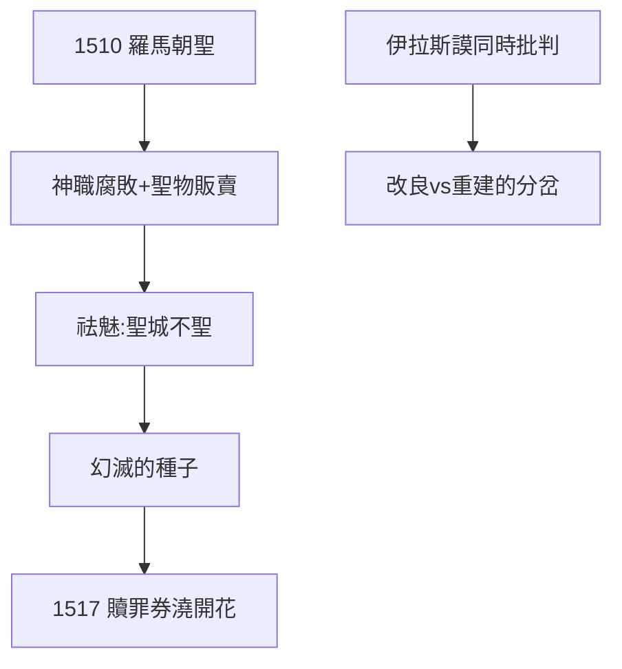

# 2.1 羅馬之旅（1510）

## 1510–11：朝聖變幻滅

路德奉命赴羅馬辦事，滿懷朝聖熱情而去，看到的卻是：神職人員包情婦、彌撒像流水線（「快點念，錢來了」）、聖物販賣明碼標價。他在聖階前一邊爬一邊念禱文，心裡卻想：「誰知道這是不是真的？」

## 幻滅的種子

- 不是一次頓悟，而是一次祛魅：聖城不聖；
- 回國後，他把羅馬見聞講給學生聽，聽眾譁然；
- 七年後（1517），贖罪券（2.3）把這顆種子澆開花。

## 歷史的對照

與路德同時，伊拉斯謨也在批判教會腐敗（《愚人頌》1509）。區別在於：伊拉斯謨要改良，路德要重建——1510 年的羅馬，同時埋下了人文主義與宗教改革兩顆種子。

**因果**：苦修的內在絕望（1.3）+ 羅馬的外在腐敗 = 雙重幻滅。路德既不信自己能修成，也不信教會能救人——剩下的路只有一條：直接讀聖經（2.2）。
