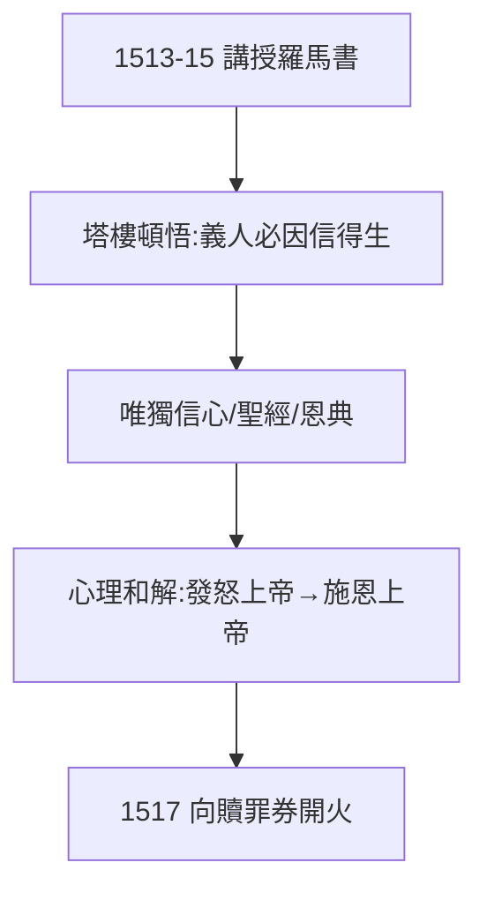

# 2.2 保羅書信的頓悟（1513–1515）

## 塔樓經驗（Turmerlebnis）

1513–15 年，路德在維滕貝格講授《詩篇》《羅馬書》，在修道院塔樓斗室中苦讀保羅：「**義人必因信得生**」（羅馬書 1:17）。他後來回憶：這句話像天堂之門打開——得救不在行為，不在贖罪券，不在教會，只在**信**。

## 因信稱義

- Sola fide（唯獨信心）：人稱義唯靠信，不靠善功；
- Sola scriptura（唯獨聖經）：權威唯在聖經，不在教皇（伏筆：4.2 德文聖經）；
- Sola gratia（唯獨恩典）：救恩是禮物，不是交易。

## 心理根源的釋放

嚴父的恐懼（1.1）+ 苦修的絕望（1.3）在此和解：發怒的上帝變成施恩的上帝。神學突破首先是心理突破——路德自己得救了，才去救別人。

**因果**：羅馬的幻滅（2.1）是否定，塔樓的頓悟是肯定——破與立齊備，1517 年的子彈上膛。下一節，扣動扳機的直接導火索：特策爾。
