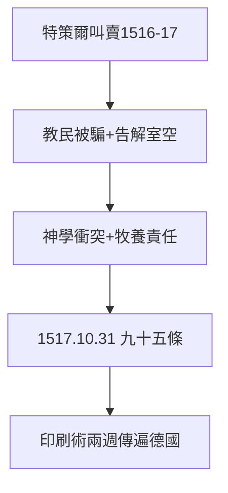

# 2.3 贖罪券與特策爾（1516–1517）

## 特策爾的叫賣

多明我會修士特策爾（Tetzel）為聖彼得大教堂籌款，在薩克森周邊兜售贖罪券，廣告詞：「**錢幣叮噹落入箱，靈魂立即跳出煉獄**」（Wenn das Geld im Kasten klingt, die Seele aus dem Fegefeuer springt）。路德的教區居民紛紛掏錢，不再來告解——動了他的奶酪，也動了他的神學（2.2）。

## 雙重動機

- 神學：贖罪券買賣與「唯獨恩典」水火不容；
- 牧養：教民被騙錢，告解室空了；
- 政治：薩克森選帝侯本就禁止特策爾入境（肥水不流外人田），路德開火有靠山。

## 1517 年 10 月 31 日前夜

路德寫好九十五條論綱，拉丁文，原意是邀請學術辯論。他沒有想到：有人把它譯成德文，印刷成小冊子（印刷術！），兩週傳遍德國，兩個月傳遍歐洲。技術（印刷機）+ 時機（民怨）+ 內容（2.2）= 爆炸。

**因果**：頓悟（2.2）是火藥，特策爾是火星，印刷機是炸藥桶。1517 年 10 月 31 日，三者相遇。下一章，決裂。
