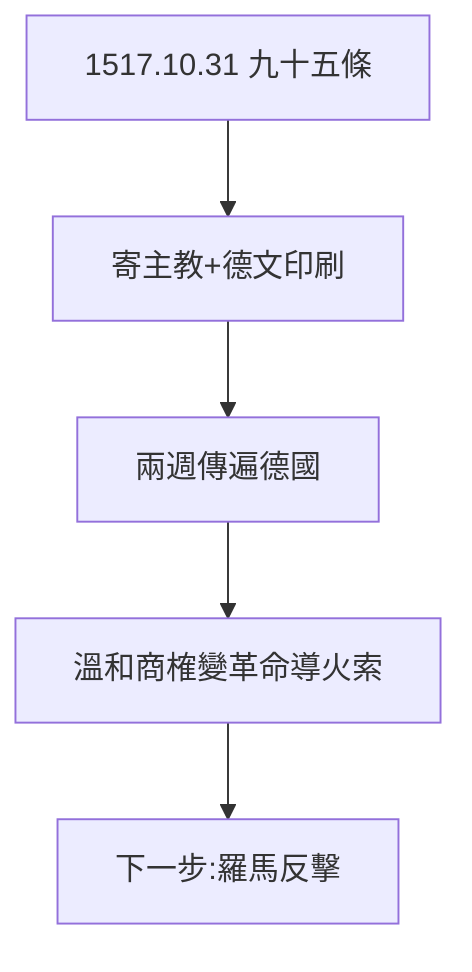

# 3.1 1517 年 10 月 31 日（1517）

## 釘不釘門？

傳說路德把九十五條釘在維滕貝格城堡教堂門上。史學家考證：很可能沒釘（他按程序寄給了美因茨大主教和勃蘭登堡主教），但「釘門」的形象深入人心——因為它象徵：**辯論公開化，權威不再壟斷真理**。

## 九十五條的內容

- 前半：為贖罪券辯護的餘地（教皇的權力、煉獄的存在暫不否定）——起點溫和；
- 後半：真正的悔改是內心的，不是花錢的；
- 基調：學術商榷，不是革命宣言——革命是被對手逼出來的（見 3.2–3.3）。

## 印刷機的奇蹟

德文譯本兩週傳遍德國——人類歷史上第一次「病毒式傳播」。沒有古騰堡（1450s），就沒有 1517。技術決定傳播，傳播決定歷史。

**因果**：贖罪券（2.3）點火，印刷機助燃。路德本想小辯一場，時代給了他大戰場。下一節，萊比錫：從改良滑向決裂。
