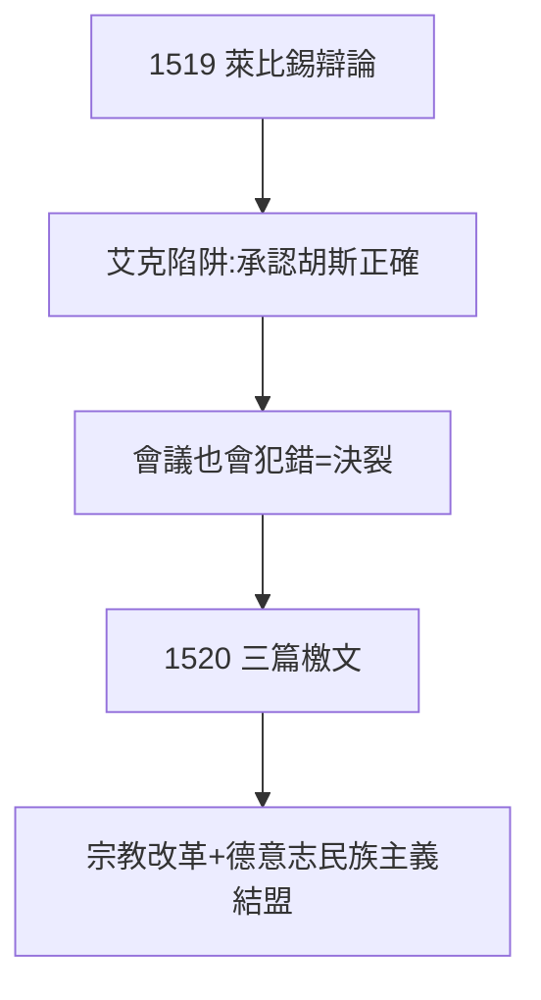

# 3.2 萊比錫辯論（1519）

## 1519 年 6–7 月

路德與天主教神學家艾克（Eck）在萊比錫公開辯論。艾克設下陷阱：逼路德承認與被定為異端的胡斯（Jan Hus，一百年前被燒死）觀點相同。路德中計（或者說將計就計），承認：「胡斯有些觀點是對的，康斯坦茨會議燒死他是錯的。」——全場譁然：這等於說教會會議也會犯錯。

## 決裂點

- 此前：批評贖罪券（教皇默許的斂財）；
- 此後：否定會議權威（教會的根基）；
- 艾克贏了辯論技巧，輸了歷史：他逼出了一個革命者。

## 1520：三篇檄文

辯論後路德連發《致德意志基督教貴族書》《教會的巴比倫之囚》《基督徒的自由》——從神學家變成民族英雄，呼籲德意志諸侯擺脫羅馬。宗教改革與德意志民族主義就此結盟（伏筆：諸侯保護他，見 3.3）。

**因果**：九十五條（3.1）是商榷，萊比錫是決裂——對手把他推過了盧比孔河。而 1520 年檄文爭取到的諸侯，將在兩年後救他的命（3.3）。下一節，沃木斯。
