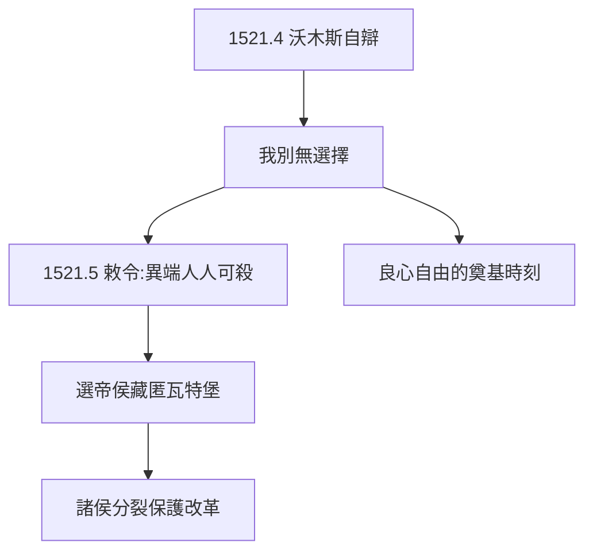

# 3.3 沃木斯議會（1521）

## 1521 年 4 月 17–18 日

新皇帝查理五世（兼西班牙國王）召開沃木斯帝國議會，傳路德自辯。桌上擺著他的著作，問：收回嗎？路德要求考慮一夜，次日回答：「**除非用聖經或理性說服我，我不能也不會收回任何東西。這是我的立場，我別無選擇。求上帝幫助我，阿門。**」（Hier stehe ich, ich kann nicht anders.）

## 絕罰與藏匿

- 1521 年 5 月《沃木斯敕令》：路德為異端，人人可殺；
- 選帝侯腓特烈三世假裝綁架，把他藏進瓦特堡（見 4.1）——1520 年檄文（3.2）爭取的諸侯，此刻兌現；
- 皇帝想殺，諸侯想保——德意志的分裂保護了改革。

## 「我別無選擇」的力量

這句話（無論原話如何）成為良心自由的奠基時刻：個人良心高於皇帝與教皇。現代性的第一聲啼哭。

**因果**：萊比錫的決裂（3.2）→ 沃木斯的定罪 → 瓦特堡的藏匿。逼迫越狠，反彈越強——而藏匿的一年（4.1）將產出德文聖經，改革從此不可逆。下一章，瓦特堡。
