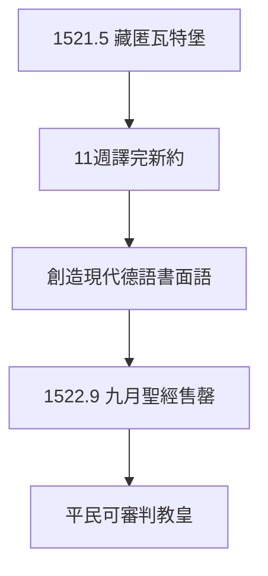

# 4.1 瓦特堡譯經（1521–1522）

## 1521 年 5 月–1522 年 3 月：化名容克·約克

路德藏身瓦特堡，留起鬍子，化名騎士。十年沒碰的希臘文撿回來，十一個星期譯完《新約》——速度驚人，品質更高：用薩克森官話融合民間口語，創造了現代德語書面語的基礎。

## 「唯獨」的聖經

*Sola scriptura*（2.2）需要一本德國人讀得懂的聖經。拉丁文武加大譯本是教士的專利，德文聖經是平民的武器——**識字的人可以直接審判教皇**。印刷機（3.1）+ 德文聖經 = 宗教改革的核武器。

## 1522 年 9 月出版

《九月聖經》（Septembertestament）出版，5000 冊幾個月售罄。此後一生修訂，到 1534 年完整版（見 4.2）。

**因果**：沃木斯的定罪（3.3）→ 瓦特堡的藏匿 → 德文新約。逼迫製造了翻譯，翻譯製造了民族語言。下一節，完整聖經與語言的統一。
