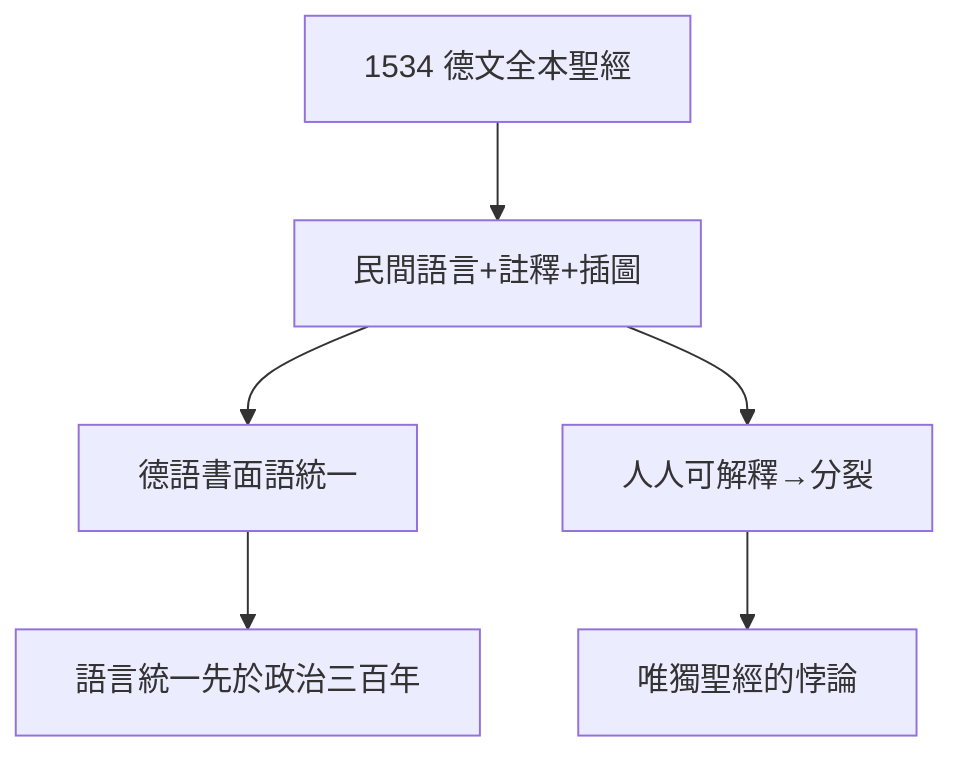

# 4.2 德文聖經（1522–1534）

## 1534：完整版

路德與梅蘭希頓等合作，1534 年出版德文全本聖經（含舊約）。特點：

- 語言：汲取民間諺語，「到人民嘴裡找詞」；
- 註釋：邊注引導讀者按路德神學理解；
- 插圖：克拉納赫（Cranach）木刻，文盲也能「看」聖經。

## 統一德語

此前德意志方言林立，路德聖經的語言成為跨地域書面語——**德國的語言統一先於政治統一三百年**。歌德說：「路德的德語，是德國文學的源頭。」

## 唯獨聖經的悖論

人人可讀聖經 → 人人可自行解釋 → 解釋分裂（見 5.1 與慈運理、5.3 農民戰爭借他的名義）。*Sola scriptura* 生出無數個 *sola*——這是路德晚年最痛的領悟。

**因果**：瓦特堡新約（4.1）的完成版。聖經統一了語言，卻分裂了教會——同一本書，既是統一者也是分裂者。下一節，分裂的第一滴血：農民戰爭。
