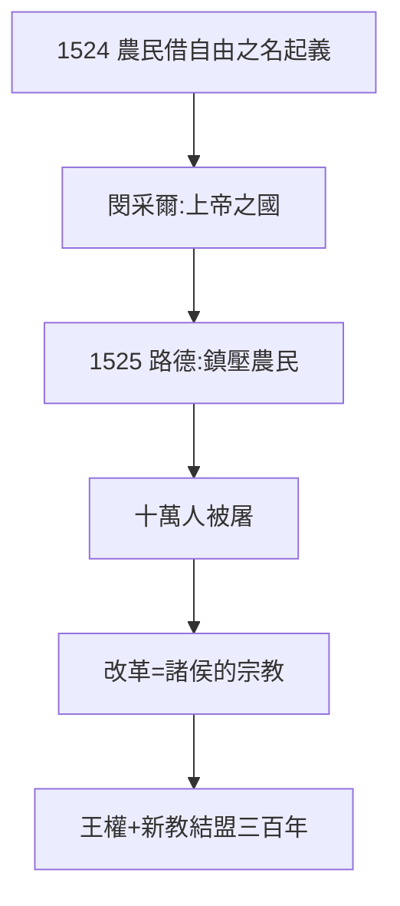

# 4.3 農民戰爭（1524–1525）

## 1524–25：三十萬農民起義

德意志農民借路德「基督徒的自由」之名，要求廢除農奴制。激進派閔采爾（Müntzer）宣稱建立上帝之國。諸侯鎮壓，屠殺約十萬人——德國歷史上最血腥的內戰之一。

## 路德的抉擇：《反殺人越貨的農民》

1525 年，路德發表小冊子，呼籲諸侯「像打死瘋狗一樣」鎮壓農民。理由：

- 他的自由是「靈魂的自由」，不是社會革命；
- 秩序高於正義：沒有諸侯保護（3.3），改革早死了；
- 現實：得罪農民，保住諸侯——改革的靠山不能倒。

## 代價

- 左派永遠的控訴：路德背叛了人民；
- 路德的辯解：閔采爾用刀劍傳福音，違背了「話語而非刀劍」的原則；
- 改革從此是「諸侯的宗教」——德意志新教與王權結盟三百年。

**因果**：德文聖經（4.2）人人可讀 → 農民讀出革命 → 路德鎮壓讀者。*Sola scriptura* 的悖論（4.2）見血了。路德選擇秩序，代價是改革的左翼永遠失去。下一章，分裂的完成。
