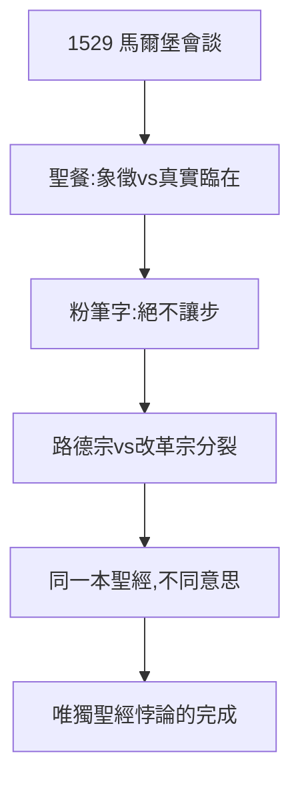

# 5.1 與慈運理分歧（1529）

## 1529：馬爾堡會談

為聯合抗敵（皇帝與教皇），黑森伯爵安排路德與瑞士改革家慈運理（Zwingli）會談。十四條談了十四條半——在聖餐問題上決裂：慈運理認為餅酒只是象徵，路德堅持「基督真實臨在」（這是我的身體，必須按字面解）。

## 決裂的名場面

路德在桌上用粉筆寫下 *Hoc est corpus meum*（這是我的身體），宣布：「除非聖經說服我，否則我不讓步。」會談破裂，新教第一次分裂：路德宗 vs 改革宗。

## 分裂的邏輯

- 與天主教決裂（3.2）用了十年；
- 與慈運理決裂用了一天——因為都讀同一本聖經（4.2 的悖論），卻讀出不同意思；
- 路德晚年感嘆：「我們以為聖經是清楚的，結果每個人都清楚出自己的意思。」

**因果**：德文聖經（4.2）→ 農民讀出革命（4.3）→ 慈運理讀出象徵說。同一病因，三次發作。路德反對教皇的權威，卻建立了自己的權威——每個改革者都成了新的教皇。下一節，信條。
