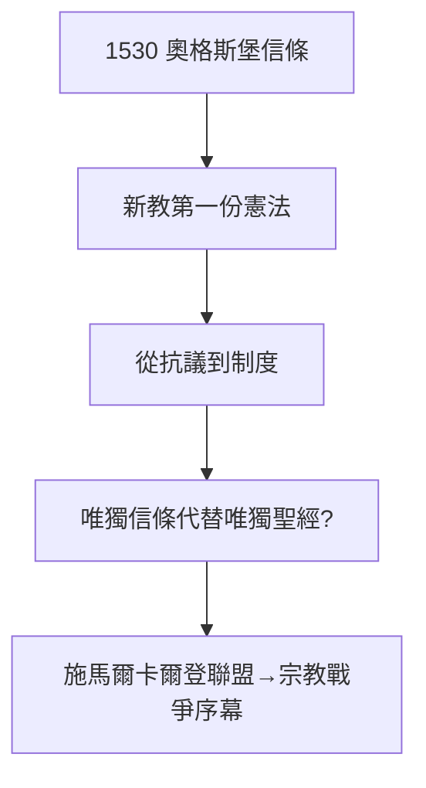

# 5.2 奧格斯堡信條（1530）

## 1530 年 6 月：帝國議會

查理五世要求新教諸侯陳述信仰，梅蘭希頓起草《奧格斯堡信條》（Confessio Augustana），路德在科堡遙控（他仍是通緝犯，不敢赴會）。信條系統闡述路德宗：因信稱義、聖禮、教會——新教的第一份憲法。

## 信條的雙面

- 正面：從個人抗議變成制度教會，改革得以傳承；
- 反面：從「唯獨聖經」變成「唯獨信條」——用新的教條代替舊的教條（5.1 邏輯的延續）；
- 政治：諸侯以信條為旗，組成施馬爾卡爾登聯盟，對抗皇帝——宗教戰爭的序幕。

## 路德的晚年心境

科堡期間，他翻譯《詩篇》、寫《桌邊談話》（Tischreden，學生記錄的閒談，後世了解他的寶庫），同時飽受腎結石、耳鳴、抑鬱折磨。英雄遲暮，仍在罵：罵教皇、罵慈運理、罵猶太人（見 5.3）。

**因果**：馬爾堡的分裂（5.1）需要用信條止血，信條需要用聯盟護衛，聯盟需要用戰爭解決——從神學到政治，一步步滑向三十年戰爭（1618）。路德種下信仰，後人收穫刀劍。下一節，謝幕與污點。
