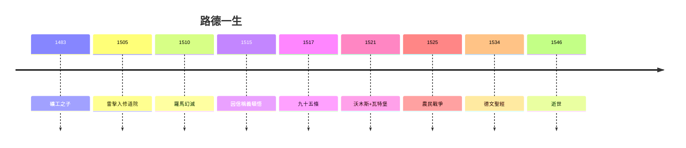

# 5.3 1546 逝世與反猶爭議（1546）

## 1546 年 2 月 18 日

路德在出生地艾斯萊本去世（調解糾紛途中），享年 62 歲。遺言：「我們都是乞丐，這是真的。」（Wir sind Bettler, das ist wahr.）——從礦工之子（1.1）到乞丐，首尾呼應。

## 反猶污點

- 早期（1523《耶穌生為猶太人》）：善待猶太人，盼其皈依；
- 晚期（1543《論猶太人及其謊言》）：因皈依無望，轉為惡毒攻擊，主張燒會堂、沒收財產；
- 納粹奉為先驅（1933 年紐倫堡集會展示此書）——這是路德傳記無法洗白的一頁。

## 蓋棺：兩面評價

| 光明 | 陰影 |
|---|---|
| 良心自由、唯獨聖經 | 唯獨信條的新教條 |
| 德語之父、教育普及 | 農民戰爭的血 |
| 反抗權威的勇氣 | 反猶的毒 |

**因果閉環**：嚴父的恐懼（1.1）→ 修道院的絕望（1.3）→ 塔樓的釋放（2.2）→ 九十五條（3.1）→ 沃木斯（3.3）→ 聖經（4.2）→ 分裂與血（4.3–5.2）→ 乞丐遺言。路德用一生證明：**釋放良心的人，不一定能駕馭被釋放的良心**。
