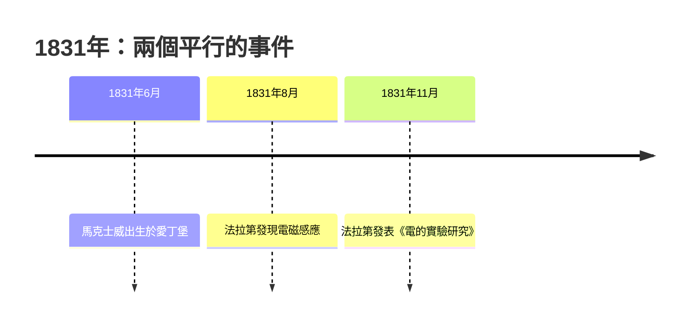

# 1.1 誕生於電磁學誕生之年

1831 年 6 月 13 日，詹姆斯·克拉克·馬克士威出生於蘇格蘭愛丁堡的印度街。這一年在物理學史上非同尋常：法拉第在倫敦皇家研究院發現了電磁感應。

## 時代的巧合

法拉第的發現改變了人類對電的認識——磁可以產生電。但法拉第是實驗家，缺乏數學訓練，他的「力線」觀念被主流數學物理學家視為不嚴格的直觀圖像。而填補這個理論空缺的人，正是在這一年出生的馬克士威。

## 家世

馬克士威出身蘇格蘭克拉克家族（原姓 Clark，後繼承 Glenlair 田莊而改姓 Maxwell）。父親約翰·克拉克·馬克士威是律師，卻熱衷科學技術，是愛丁堡皇家學會會員。這個家庭提供了兩樣關鍵資源：

1. **經濟獨立**——他一生不必為生計妥協研究方向；
2. **科學氛圍**——父親常帶他參加愛丁堡皇家學會的活動。

因果鏈條在此已經清晰：父親的科學興趣 → 幼年接觸學術圈 → 早熟的天才得以被發現與培養。
