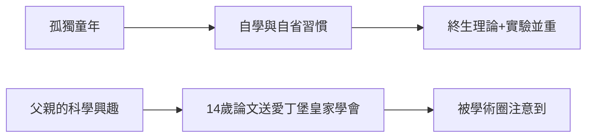

# 1.2 孤獨的好奇孩子

馬克士威幼年在格倫萊爾田莊度過，由母親啟蒙。8 歲時母親死於腹部腫瘤，此後由父親與家庭教師教養。

## 三歲的問題

據家族記載，幼年馬克士威不停地問：「那是怎麼回事？它為什麼會那樣做？」凡物必究其因。母親死後，這種孤獨反而深化了他自學與自省的習慣。

## 早期的兩件作品

- **14 歲發表第一篇論文**《論橢圓曲線之描繪》（1846，由父親代讀於愛丁堡皇家學會）。他推廣了笛卡爾的橢圓畫線法、卵形線的性質。
- **動手製作**：他終生保持「理論＋動手」的雙重性格，會親手做力學模型、風箏、化學實驗。

這段時期塑造了馬克士威方法論的核心：**不滿足於「是什麼」，必須追問「為什麼、如何」**——這正是日後他把法拉第的實驗現象轉化為數學結構的性格基礎。
