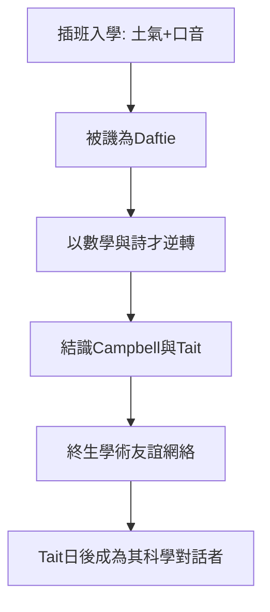

# 1.3 愛丁堡公學與「笨蛋」的逆轉

1841 年，10 歲的馬克士威進入愛丁堡公學（Edinburgh Academy），插班二年級。

## 被嘲笑的鄉下人

他穿著父親設計的土氣衣服、操蘇格蘭土腔，同學給他起綽號「Daftie」（笨蛋）。起初他孤立無援。

## 逆轉的時刻

轉折發生在數學與詩才上：三年級期末，他在聖經知識、英語、數學上名列前茅；一次獎學考試中，他把古英語詩翻譯得最好、數學解法最優雅，一舉成為同儕領袖。嘲笑他的人轉而追隨他。

## 兩位終生的摯友

在公學結識的劉易斯·坎貝爾（Lewis Campbell，後為其作傳）與 P. G. 泰特（P. G. Tait，後為蘇格蘭著名數學物理學家），構成了他終身的友誼與學術對話網絡。

**因果分析**：童年受辱經歷使馬克士威不追求表面榮譽，而以理解的深度為自我價值標準——這解釋了他日後為何願意花數年研究「不熱門」的土星環與氣體分子，而非追逐時髦課題。
