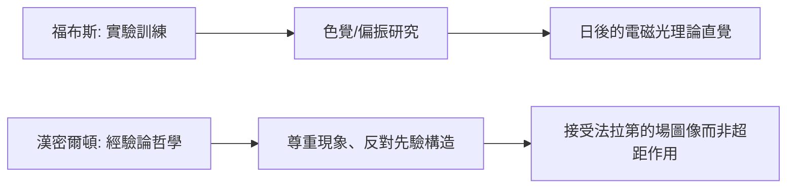

# 2.1 愛丁堡大學的早慧歲月

1847 年，16 歲的馬克士威進入愛丁堡大學，師從自然哲學教授詹姆斯·福布斯（James Forbes）與邏輯學家威廉·漢密爾頓爵士。

## 三門學科的合力

- **福布斯**：教他實驗物理的嚴謹（偏振光、色覺研究由此啟蒙）；
- **漢密爾頓**：教他經驗主義哲學——一切知識源於經驗，但需要形式化；
- **數學家凱蘭（Kelland）**：打下沉實的分析基礎。

## 色覺實驗的起點

在福布斯指導下，馬克士威做了混色實驗與偏振光研究。這段經歷的直接後果是：**1855–1860 年的色覺三原色理論與第一張彩色照片**。更深的後果是養成了一個習慣——用幾何與向量思考光與顏色的結構。

**關鍵的因果線**：愛丁堡的經驗主義訓練，使他日後敢於拋棄劍橋主流的超距作用教條，採納被巴黎數學家看不起的法拉第力線——因為哲學上「貼近經驗的圖像」優先於「形式優雅的公式」。
