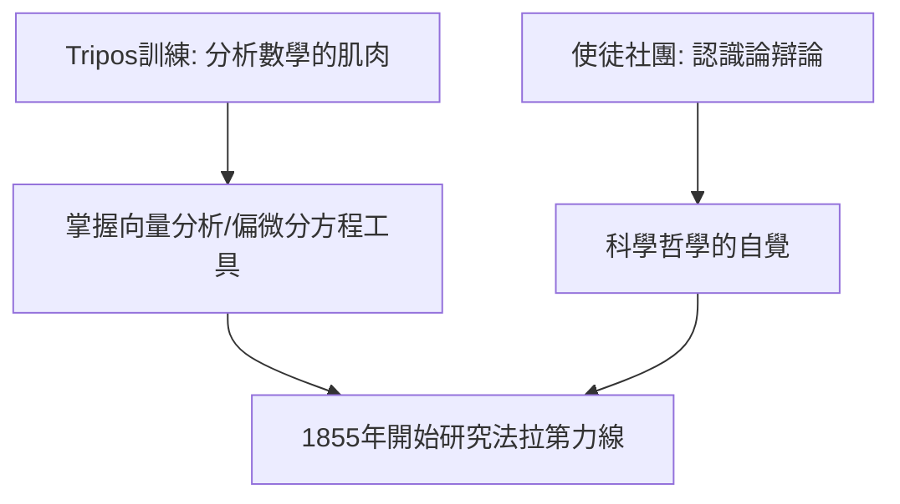

# 2.2 劍橋三一學院與使徒社團

1850 年 10 月，馬克士威轉入劍橋大學彼得豪斯學院，一學期後轉入三一學院。

## 為何轉學劍橋

父親希望他將來接班律師，劍橋數學榮譽學位（Mathematical Tripos）是當時英國最有權威的學術門檻。更深層的原因：愛丁堡大學數學水準已不能滿足他，而劍橋的斯托克斯（G. G. Stokes）與惠威爾（William Whewell）代表數學物理的最高標準。

## Wrangler 生涯

1854 年，他以甲等第二名（Second Wrangler）畢業，與第一名勞斯（E. J. Routh）並列 Smith 獎得主。他沒有應試技巧，但理解力深不可測——這是「深度」對「速度」的勝利。

## 使徒社團（Apostles）

他當選使徒社團成員，成員每周討論哲學、倫理與社會問題。在這裡他遇到的問題不是「如何計算」，而是「知識是什麼、科學方法的界限在哪裡」。

**因果**：Tripos 給了他**工具**（後來把力線寫成偏微分方程的數學能力），使徒社團給了他**哲學立場**（現象優先、反對獨斷）——兩者疊加，才有能力與膽量去「翻譯」法拉第。
