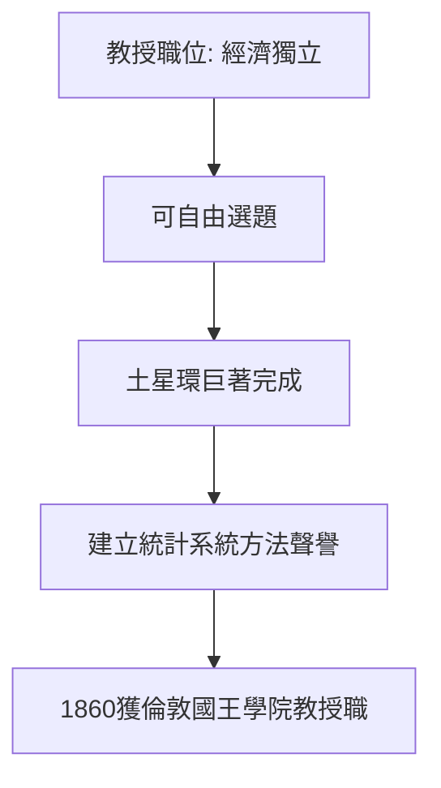

# 3.1 馬里歇爾學院與土星環論文

1856 年，年僅 25 歲的馬克士威出任阿伯丁馬里歇爾學院（Marischal College）自然哲學教授。

## 為何是阿伯丁

父親病重，蘇格蘭職位可以就近照顧格倫萊爾田莊。學院選他，部分因為愛丁堡學術圈的推薦。這個職位使他經濟獨立，但也負擔繁重的教學。

## 1857–1858：完成土星環論文《論土星環的穩定性》

九十頁的長文，被喬治·艾里（George Airy）譽為「自牛頓以來應用力學最傑出的應用之一」。

## 1858：與凱瑟琳·迪尤爾結婚

凱瑟琳（Katherine Mary Dewar）是院長之女，年長他七歲。她成為他實驗的助手——在倫敦時期親手幫他測量氣體黏滯性。這段婚姻與他的實驗生涯緊密交織。

**因果**：土星環論文的聲譽直接促成 1860 年他被倫敦國王學院聘任——而倫敦正是法拉第所在之地，兩人的直接交往改寫了電磁學史。
