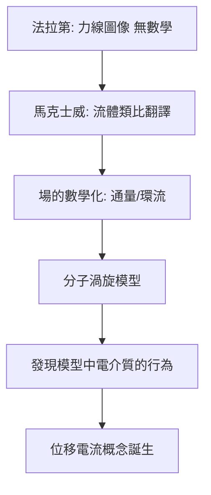

# 3.3 《論法拉第的力線》：電磁學的開端

1855–1856 年（還在劍橋時），馬克士威發表第一篇電磁論文《論法拉第的力線》。這是他與法拉第對話的開始。

## 為何選法拉第

當時英國電磁學兩大陣營：

- **大陸學派**（安培、韋伯）：超距作用，數學精緻；
- **法拉第**：力線、場的連續傳播，但缺乏數學。

馬克士威的判斷：法拉第的圖像更貼近實驗事實（尤其是電磁感應的即時性），值得「翻譯」成數學。

## 方法：流體力學類比

他用不可壓縮流體的流線類比電場——「通量」「散度」的概念由此產生。這使力線從圖像變成**可計算的數學對象**。

$$\nabla \cdot \mathbf{D} = \rho$$

## 1861–1862：《論物理力線》

在倫敦時期，他更進一步：用「分子渦旋」力學模型來類比磁場，並在 1861 年 12 月與 1862 年 1 月的兩篇論文中引入了**位移電流**的觀念。

**因果**：位移電流不是憑空想像，而是從「分子渦旋」這個力學模型的內部邏輯中**被擠出來**的。模型是腳手架——建築完成後被拆除，但它引導了正確的方程。

1860 年他初次拜訪法拉第，法拉第寫道：「當我把數學應用於主題時，我不認為這是壞事……」兩人形成實驗與理論的完美互補。
