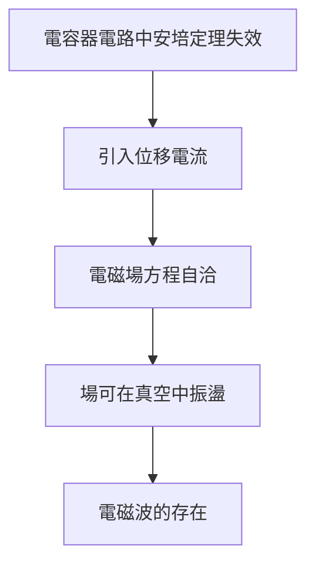

# 4.1 位移電流的靈光

1861 年，在倫敦國王學院任教期間，馬克士威做出他一生最重要的概念突破：**位移電流**。

## 問題的來源

安培環路定理 $\nabla \times \mathbf{H} = \mathbf{J}$ 在含電容器（介電質）的電路中自相矛盾——在極板之間 $\mathbf{J}=0$，環路積分卻不為零。數學結構出現裂縫。

## 解決方案

在分子渦旋模型中，電介質內的電荷位移隨時間變化也會「推動」渦旋。引入：

$$\mathbf{J}_{\text{total}} = \mathbf{J} + \frac{\partial \mathbf{D}}{\partial t}$$

於是安培定理修正為：

$$\nabla \times \mathbf{H} = \mathbf{J} + \frac{\partial \mathbf{D}}{\partial t}$$

## 這一項的深遠後果

位移電流的數量級看似微小（在當時實驗中難以直接測量），但它在**真空**中不為零——這意味著**電磁擾動可以在空無一物的空間中傳播**。

**因果分析**：這不是為了漂亮而補的項，而是**數學一致性**的要求驅動的。馬克士威深信「方程的形式正確性反映了物理的真實性」——這是理論物理史上第一次由「數學自洽性」直接導出新的物理實體。

1865 年，他進一步拋棄了分子渦旋模型，只留下場方程本身——腳手架拆除，建築矗立。
