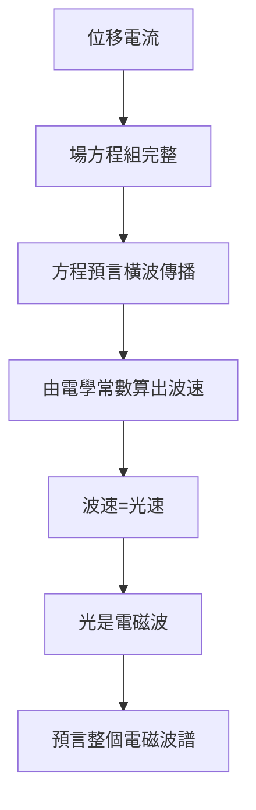

# 4.3 光是電磁波

1861–1862 年的論文中，馬克士威做了那個改變物理學的計算：電磁擾動的傳播速度等於什麼？

## 那個著名的數字

由電磁量可算出傳播速度：

$$c = \frac{1}{\sqrt{\mu_0 \varepsilon_0}}$$

代入韋伯與科爾勞施 1856 年測得的電磁單位比值，得到約 $3.1 \times 10^8\ \mathrm{m/s}$——與菲佐（Fizeau）測得的光速 $3.14 \times 10^8\ \mathrm{m/s}$ 驚人吻合。

## 結論

> 「我們幾乎無法避免這個推論：光是同一介質中傳播的電磁擾動的橫波。」

電、磁、光——三個看似無關的現象——被統一了。這是牛頓以來最偉大的物理綜合。

## 論證的邏輯鏈

**因果**：這一步的力量來自**兩套獨立測量**（電學常數 vs 光學測量）的數值巧合。這類「獨立測量數值吻合」是物理學中最強的證據形式——20 年後赫茲產生電磁波，才完成實驗層面的最終確認（見 5.3）。

光譜的統一還孕育了更遠的後果：1888 年赫茲的無線電波、1895 年倫琴的 X 射線，都是這一統一的子孫。
