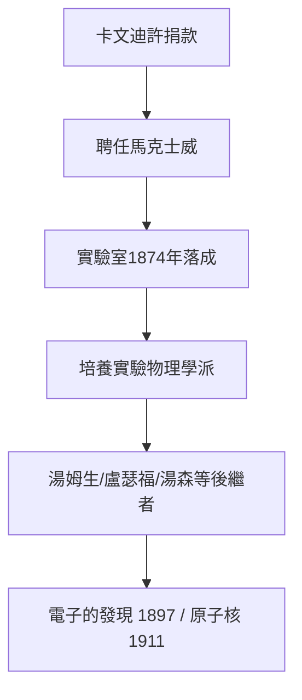

# 5.1 創建卡文迪許實驗室

1871 年，馬克士威受聘為劍橋首任卡文迪許實驗物理教授（Cavendish Professor），並受命設計與領導新建的實驗室。

## 為何是馬克士威

威廉·卡文迪許（Devonshire 公爵）捐款建實驗室，需要一位既有理論聲望、又懂實驗的人。馬克士威的雙重資質（愛丁堡的實驗訓練 + 倫敦的氣體黏滯性實驗）使他成為不二人選。

## 艱難的起步

- 當時劍橋重數學輕實驗，實驗物理被視為「工匠之事」；
- 實驗室 1874 年才落成，他自掏腰包補貼設備（還捐出處理亨利·卡文迪許遺稿的報酬）；
- 他親手設計儀器、培養第一批學生。

## 學風的確立

他倡導「**自由討論、親自動手、公開批評**」的風格，拒絕把實驗室變成教授的私人王國。

**因果**：卡文迪許實驗室成為 20 世紀實驗物理的搖籃——電子的發現（J. J. 湯姆生，1897）與原子核的發現（盧瑟福，1911）都發生於此。馬克士威親手播下的制度種子，結出了他未及親見的果實。
