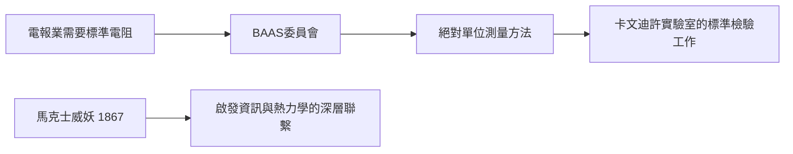

# 5.2 科學的社會化：標準與度量

馬克士威晚年把大量精力投入「科學的基礎設施」——他認為科學要成為公共事業，必須有統一的標準。

## 電學單位的標準化

1861 年起，他參與英國科學促進會（BAAS）的電阻標準委員會，與韋伯、開爾文等人合作，建立歐姆的「絕對測量」標準。這項工作的直接產物：

1. **電學單位進入可複現的實驗規程**（商業電報業也依賴它）；
2. 卡文迪許實驗室早期的主要任務之一就是**複製與檢驗標準電阻**。

## 整理亨利·卡文迪許手稿

他花了五年整理 18 世紀科學家亨利·卡文迪許的未發表手稿（1879 年出版）。卡文迪許早在庫侖之前就以扭秤測量了靜電力——這份整理本身就是電學史的考古。

## 科學史與科學方法的寫作

《物質與運動》（Matter and Motion, 1877）、《熱學理論》（Theory of Heat, 1871，其中提出**馬克士威妖**思想實驗，質疑熱力學第二定律的統計基礎）。

**因果**：馬克士威妖（1867）看似遊戲之作，實際預告了 20 世紀「資訊–熵」的深刻關聯（蘭道爾原理）。他晚年所有「基礎設施式」的工作，共同確立了現代科學的**公共性與可重複性**原則。
