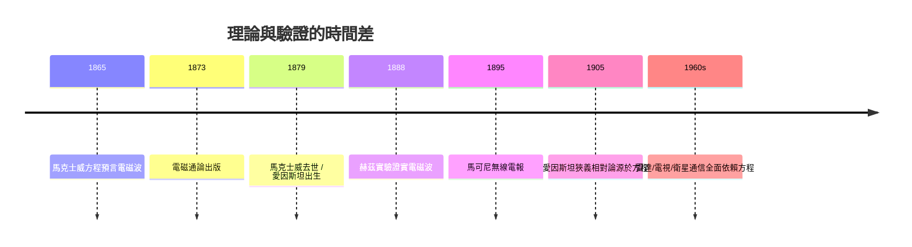

# 5.3 落幕與遺產：赫茲的驗證

1879 年 11 月 5 日，馬克士威因腹部癌症（與其母同樣的疾病，同為 48 歲前後）在劍橋去世。他不知道，幾年後他的理論將被徹底證實。

## 1879：愛因斯坦誕生之年

馬克士威死的那一年，愛因斯坦出生。愛因斯坦自述：他 1905 年的工作正是「馬克士威理論的直接延伸」——狹義相對論的兩個公理之一就是「光速不變」，而這源自馬克士威方程。

## 1886–1888：赫茲的實驗

赫茲在卡爾斯魯厄用振盪火花間隙產生並檢測到電磁波，並證明它們：

- 服從反射、折射、干涉定律（像光一樣）；
- 傳播速度與光速相同。

馬克士威 25 年前的預言完全兌現。

## 遺產的層次

1. **理論**：方程組成為現代物理的範本（愛因斯坦的場論、楊–米爾斯規範場論皆是其後裔）；
2. **方法**：統計思維（分子運動論 → 玻爾茲曼 → 統計力學）；
3. **制度**：卡文迪許實驗室培養了整個 20 世紀實驗物理；
4. **技術**：一切無線通信的源頭。

## 結語

馬克士威墓誌上可寫：**他讓看不見的「場」成為物理學的主角，並預言了人類將用看不見的波交談。**

從 1831 年法拉第的電磁感應，到 1888 年赫茲的火花，這條因果長鏈的樞紐正是馬克士威——一個把實驗家的直觀翻譯成數學、又讓數學預言新的實驗的人。
